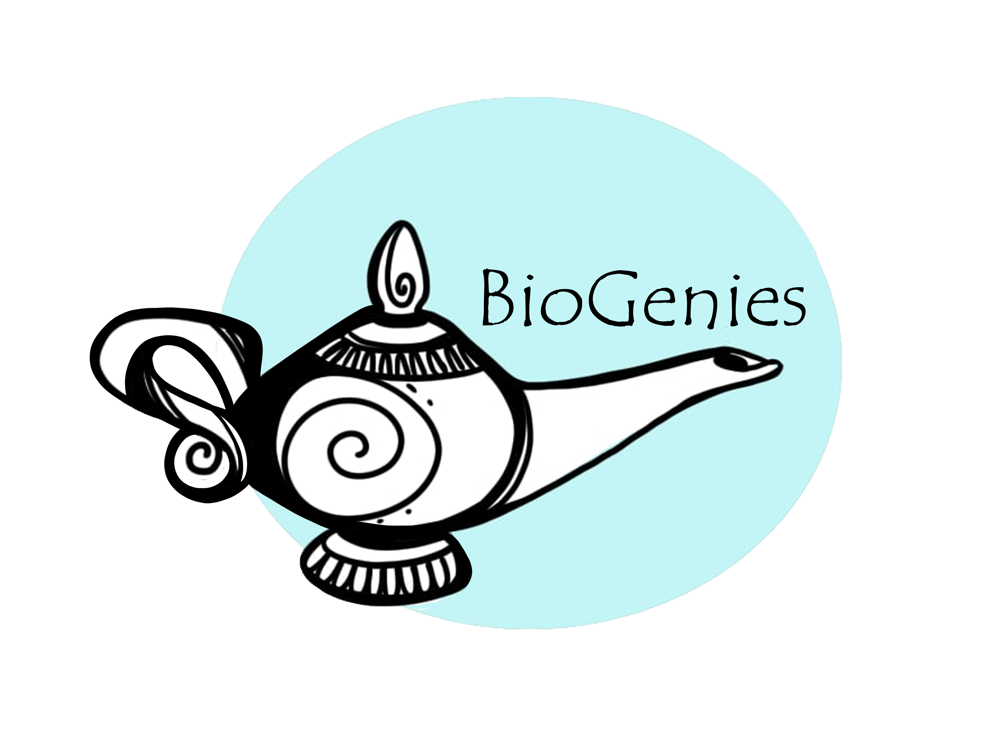

# About BioGenies

A research collective connecting bioinformatics, multiomics and protein science. Meet BioGenies at the Medical University of Białystok and across our collaborating institutions.

SCIENCE THROUGH CONNECTIONS

## Biological questions. Computational imagination.

We are BioGenies: a research community bringing together bioinformatics, multiomics, protein science and machine learning. We build methods, data resources and software to connect molecular observations with biological understanding.

[Meet our people](../subsite/team.llms.md) [Explore our research](../subsite/research.llms.md)

## What brings us together

01 / MOLECULES

### How do proteins interact and assemble?

We investigate amyloid aggregation, its modulators and the interactions that shape protein behaviour, connecting sequence and structure with experiments.

[Amyloids & aggregation](../subsite/topics/amyloids.llms.md) · [Phase separation](../subsite/topics/llps.llms.md)

02 / DATA

### How can we learn more from omics data?

We develop approaches to missing values and multiomics analysis, with an emphasis on comparing methods and making analyses reproducible.

[Missing-value imputation](../subsite/topics/mvi.llms.md) · [HDX-MS](../subsite/topics/hdxms.llms.md)

03 / METHODS

### How do we turn research into useful tools?

We combine curated biological knowledge, statistical modelling and machine learning in resources that other researchers can explore and reuse.

[Software & databases](../subsite/software.llms.md) · [Antimicrobial peptides](../subsite/topics/amp.llms.md)

PEOPLE MAKE THE SCIENCE

## A shared curiosity, across institutions.

Our work grows through conversations, shared experiments and the different perspectives of our [team](../subsite/team.llms.md), [collaborators](../subsite/colab.llms.md) and [guest researchers](../subsite/guest.llms.md). Conferences and research exchanges help us build those connections; time together outside the lab matters too.

[Life in the group →](../subsite/posts/2025_06_23_arboretum.llms.md)

BioGenies members celebrating together at the 2025 Wrocław retreat.

OUR HOME BASE

## Find us in Białystok

Our core team is based in the **Bioinformatics and Multiomics Analysis Laboratory**, part of the **Clinical Research Centre** at the **Medical University of Białystok**, Poland.

**Centrum Futuri · entrances D and E**

[Open location in Google Maps ↗](https://www.google.com/maps/search/?api=1&query=53.12324,23.15935) · [University website ↗](https://www.umb.edu.pl/en/index.php)
