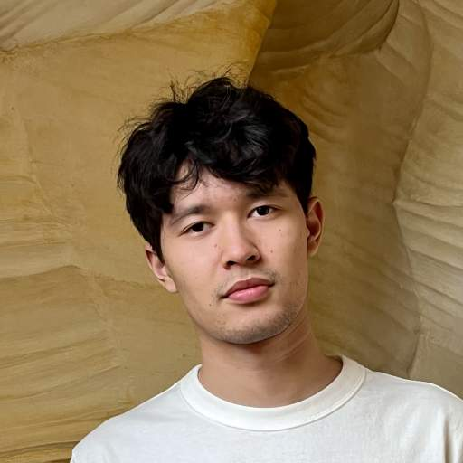

# Part of our story

Meet former BioGenies members and explore the people who contributed to our research community.

The people who have helped shape BioGenies. Our former members remain part of the group’s story.

[Meet the current team](../subsite/team.llms.md) · [Our collaborators](../subsite/colab.llms.md)

### Sonor Kubkowski

University of Wrocław

Research profile ↗

AB

### Agnieszka Barbach

Wrocław University of Science and Technology

### Filip Gaj

University of Wrocław

KH

### Katarzyna Hubicka

Wrocław University of Science and Technology

AK

### Anita Karaszewska

University of Wrocław

DK

### Dominika Kozakiewicz

University of Wrocław

AL

### Anna Lassota

University of Wrocław

DN

### Dominik Nowakowski

Medical University of Białystok

FP

### Filip Pietluch

University of Wrocław

NP

### Natalia Pludra

University of Wrocław

DR

### Dominik Rafacz

Warsaw University of Technology

JS

### Joanna Sikorska

University of Wrocław

JS

### Jadwiga Słowik

Warsaw University of Technology

