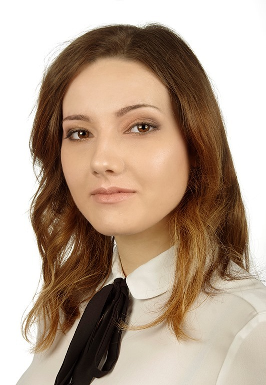
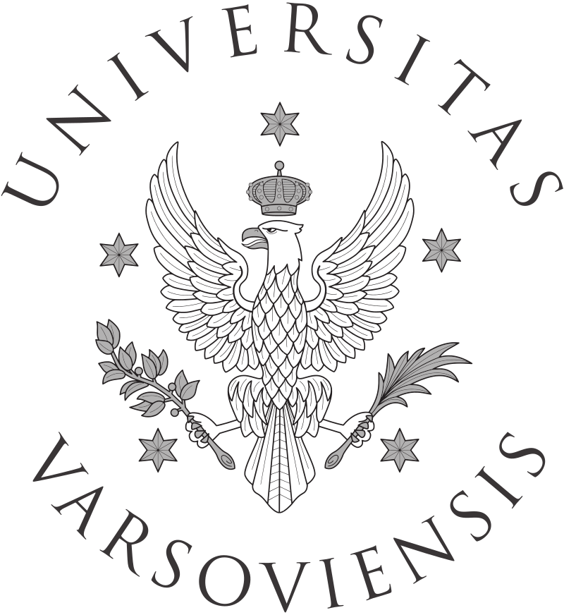
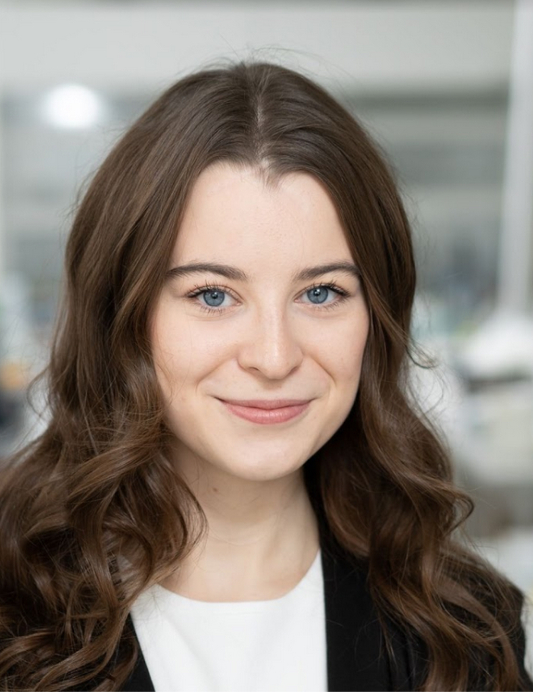

# Working together

Meet the BioGenies collaborators and explore their research profiles across our partner institutions.

Good questions cross institutional boundaries. Meet the people who bring their expertise, ideas and perspectives to our research.

[Our team](../subsite/team.llms.md) · [Guest researchers](../subsite/guest.llms.md) · [Research & impact](../subsite/research.llms.md)

##  Autonomous University of Barcelona

### Eva Arribas

Autonomous University of Barcelona

Research profile ↗

### Oriol Bárcenas

Autonomous University of Barcelona

Research profile ↗

### Carlos Pintado-Grima

Autonomous University of Barcelona

Research profile ↗

##  Brandenburg University of Technology Cottbus-Senftenberg

SR

### Stefan Rödiger

Brandenburg University of Technology Cottbus-Senftenberg

Research profile ↗

### Ronja Tittel

Brandenburg University of Technology Cottbus-Senftenberg

Research profile ↗

##  Nencki Institute of Experimental Biology PAS

KN

### Kinga Nazaruk

Nencki Institute of Experimental Biology PAS

##  University of Porto

### Martyna Podlasiak

University of Porto

Research profile ↗

##  University of Warsaw

### Julia Szkóp

University of Warsaw

Research profile ↗

##  Quadram Institute

RK

### Rafał Kolenda

Quadram Institute

Research profile ↗

KS

### Katarzyna (Kasia) Sidorczuk

Quadram Institute

Research profile ↗
