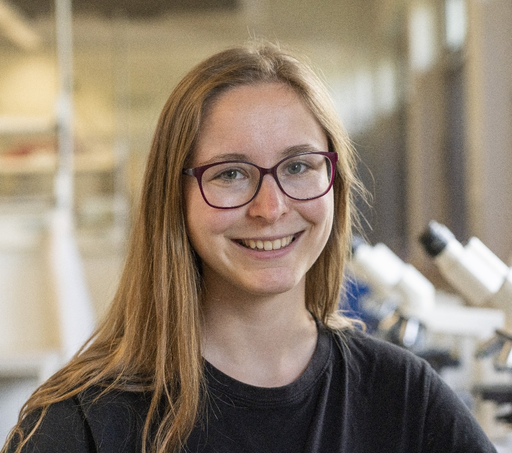

# Come research with us

Learn about Erasmus+ and international research placements at BioGenies, and read the experiences of our guest researchers.

Explore bioinformatics and protein science in an international, collaborative research group. Hear from the people who have spent a placement with us.

## A placement with BioGenies

Work on real research questions in [our research topics](../subsite/research.llms.md#our-research-topics), develop practical computational and analytical skills, and learn alongside the [team](../subsite/team.llms.md). Contact us to discuss current Erasmus+ and international internship opportunities, projects and practical arrangements.

[Discuss a placement ↗](mailto:biogenies@umb.edu.pl)

## In their own words

Eva about her Erasmus+ Mobility internship Oct 2024 - Jan 2025

My Erasmus experience in Białystok has been truly unforgettable, thanks to the amazing team I had the privilege to work with. From the very beginning, they made my integration seamless, even going the extra mile to set up a fully equipped kitchen, providing everything from casseroles to cutlery. Beyond that, they fostered a strong sense of fellowship by organizing regular team-building activities, such as trips and fun dinners together.

What really stood out, though, was how outstanding this team is in the field of Bioinformatics. They are not only highly active in conducting cutting-edge research with multiple ongoing projects and publications, but they also offer exceptional mentorship. Whenever I had doubts, they were always there to guide me, providing valuable insights that helped me improve my skills and grow as a researcher. This experience has truly been enriching, both personally and professionally.

BioGenies truly became my small Polish family during my time in Białystok.

Ronja about her Leonardo/Erasmus+ praxissemester Sep 2024 - Feb 2025

From the very first moment, I felt incredibly welcomed by the group—it was honestly amazing! Everyone was so kind and supportive, always ready to help with any research, answer my questions, or just be there whenever I needed something.

They organized so many fun activities to explore Białystok and the surrounding areas, making it really easy to get to know the city and meet new people. They also helped me with all the necessary paperwork, which was such a relief. Finding a place to stay was completely stress-free because they quickly helped me organize a flat in the student dorms. On top of that, they even provided kitchen necessities, so I didn’t have to buy anything for five months—such a thoughtful gesture!

One thing I truly appreciated was how much effort they put into helping me find a riding stable that suited me. Even though it turned out to be a bit difficult for me in the surrounding area, they still did everything they could to help, which meant a lot.

The work atmosphere here is just incredible. I always felt comfortable and knew I could trust everyone with any problem. It’s not just a group—it feels like a community where everyone looks out for each other. I couldn’t have asked for a better experience! Thank you for letting me stay with you!

Maria about her Erasmus+ Mobility internship Nov 2024 - Jun 2025

My Erasmus stay in Białystok has been an incredible experience so far! The group welcomed me with open arms, and they are always eager to teach me new things and help me grow. Whenever I have any questions, they are quick to lend a hand and offer support. The social life here is fantastic, and it’s a great opportunity to experience the true spirit of Podlasie. We’ve had amazing integrative trips, such as to Białowieża, and we’re soon going to Suprasl. I’ve also had the chance to explore traditional Podlaskie cuisine, which has been a delightful experience. I’m really looking forward to the rest of my time here!

## Start a conversation

Tell us about your interests, background and possible placement dates: <biogenies@umb.edu.pl>.
