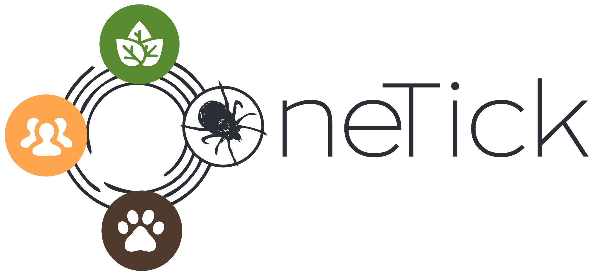

# OneTick

An integrated approach to preventing, detecting and treating tick-borne diseases in urban and peri-urban environments.

HORIZON EUROPE · MSCA STAFF EXCHANGES

## One Health, connected across disciplines.

An integrated approach to preventing, detecting and treating tick-borne diseases in urban and peri-urban environments.

One Health · Ecology · Predictive modelling

Programme  
Horizon Europe · MSCA Staff Exchanges

Grant ID  
101236599

Start date  
1 Jan 2026

Duration  
48 months

Budget  
€450,900.00

## The research question

OneTick brings ecology, predictive modelling and biomedical research together within a One Health framework. The project connects the study of ticks, hosts and pathogens with biomarker discovery and public outreach, supported by international and interdisciplinary staff exchanges.

## What the project sets out to do

01 / RESEARCH AIM

### Understand urban tick ecology

Assess tick abundance, diversity and pathogens, and model the relationships between ticks, hosts and disease spread (WP1–2).

02 / RESEARCH AIM

### Connect biology and diagnostics

Investigate biomarkers and develop diagnostic models (WP3).

03 / RESEARCH AIM

### Share knowledge and practice

Create public guidelines and educational campaigns (WP4). Support exchange through 90 person-months of secondments: 60 intersectoral and 30 interdisciplinary.

## People & support

**Project lead:** [Michał Burdukiewicz](../../subsite/team/mb.llms.md). **Proposal development:** Michał Burdukiewicz, Jarosław Chilimoniuk and Valentín Iglesias.

European Commission \| European Research Executive Agency

**Full project title**  
OneTick: An Integrated One Health Approach for Prevention, Detection and Treatment of Tick‑Borne Diseases in Urban and Peri‑Urban Environments

## Explore further

[Group publications](../../subsite/publications.llms.md) · [Group news](../../index.llms.md)

[Grant record on CORDIS ↗](https://cordis.europa.eu/project/id/101236599)

[Visit the OneTick website ↗](https://onetick.eu/) · [Grant DOI](https://doi.org/10.3030/101236599)
