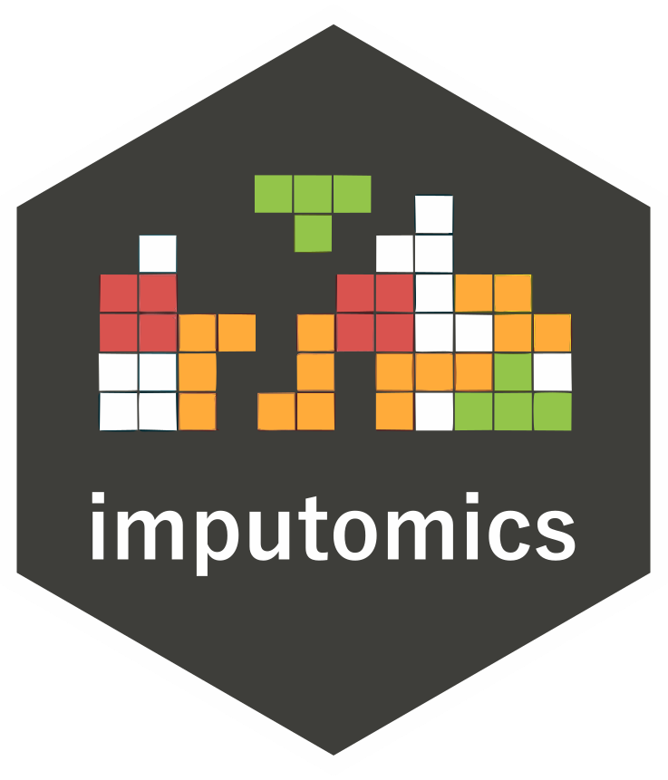

# Research & impact

Explore BioGenies publications, software and databases, conference contributions, fellowships and scientific recognition.

From biological questions to tools others can use. Explore the papers, software and shared ideas that grow out of our research.

[01 / Publications](#publications)[02 / Software](#software)[03 / Conferences](#conferences)[04 / Recognition](#recognition)

01 / KNOWLEDGE

## Ideas, tested and published.

Our work connects bioinformatics and machine learning with amyloids, antimicrobial peptides and multiomics. Read the papers and discover the methods behind the results.

[Explore our publications ↗](../subsite/publications.llms.md)

### A closer look

[Three stories in plain language →](../subsite/stories.llms.md)

[AmyloGraph: mapping amyloid interactions](../subsite/posts/amylograph.llms.md)

[imputomics: handling missing omics data](../subsite/posts/imputomics.llms.md)

[HaDeX: exploring protein dynamics](../subsite/posts/hadex2.llms.md)

02 / OPEN TOOLS

## Built for the next discovery.

We turn research methods into software, web applications and curated databases. Explore resources you can use in your own work.

[All software & databases ↗](../subsite/software.llms.md)

[Try the interactive missing-data demo →](../subsite/imputation-demo.llms.md)

[ **AmyloGraph** Amyloid interaction database](../subsite/posts/amylograph.llms.md)

[ **imputomics** Missing data imputation](../subsite/posts/imputomics.llms.md)

[ **HaDeX** HDX-MS data analysis](../subsite/posts/hadex2.llms.md)

03 / SCIENTIFIC EXCHANGE

## Good science travels.

Talks, posters, workshops and research visits connect our group with the wider scientific community. Explore where we share our work and the conversations it starts.

[Conference contributions ↗](../subsite/conferences.llms.md)

### Beyond the paper

[Meet the team and explore our mobility](../subsite/team.llms.md#our-mobility)

[Seminars and shared learning](../subsite/seminars.llms.md)

[Stories from the group](../index.llms.md)

## Our research topics

Explore the questions behind the work, with introductions to each field and links to the relevant publication stories.

[Amyloids](../subsite/topics/amyloids.llms.md) · [Antimicrobial peptides](../subsite/topics/amp.llms.md) · [Phase separation](../subsite/topics/llps.llms.md) · [Missing data](../subsite/topics/mvi.llms.md) · [HDX-MS](../subsite/topics/hdxms.llms.md)

## Recognition & milestones

The people and collaborations behind our research have earned fellowships, awards and academic milestones. Here are a few of their stories.

2025 · Scientific recognition

### Rector’s Awards for BioGenies

[Michał Burdukiewicz](../subsite/team/mb.llms.md) and [Jarosław Chilimoniuk](../subsite/team/jc.llms.md) received First Degree Rector’s Awards for publications; [Valentín Iglesias](../subsite/team/vi.llms.md) received a Second Degree award. Michał was also recognised for his SONATA grant.

[Read the Rector’s Awards story →](../subsite/posts/2025_12_16_rector_awards.llms.md)

2025 · European fellowship

### An ERA Fellowship for Jarek

[Jarosław Chilimoniuk](../subsite/team/jc.llms.md) received a Horizon Europe ERA Talents Postdoctoral Fellowship to investigate small molecules and amyloid polymorphism at Vilnius University.

[Explore the fellowship and research plans →](../subsite/posts/2025_05_19_jarek_fellowship.llms.md)

2024 · Scientific recognition

### Recognising research publications

[Michał Burdukiewicz](../subsite/team/mb.llms.md) received the First Degree Award from the Rector of the Medical University of Białystok for his publications from 2023.

[Read about Michał’s award →](../subsite/posts/2024_12_06_rector_award.llms.md)

2025 · Our wider research community

### Ronja’s Women’s Advancement Award

[Ronja Tittel](../subsite/colab/rt.llms.md), who completed a research placement with BioGenies, was honoured at BTU Cottbus-Senftenberg for her work.

[Discover Ronja’s achievement →](../subsite/posts/2025_07_02_ronja_award.llms.md)

### Science is a collective effort.

[Meet the people behind BioGenies ↗](../subsite/team.llms.md) · [Theses and dissertations ↗](../subsite/theses.llms.md)
