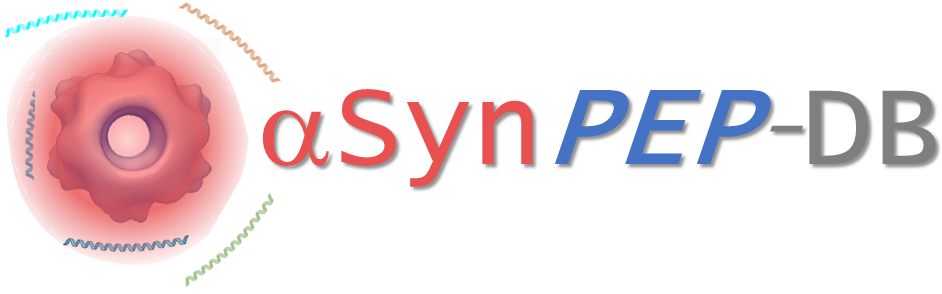

# Software & databases

Explore BioGenies web applications, R packages, databases and open research software.

Research methods, ready to use. Explore the web applications, databases and R packages developed by our team. Read the [research stories behind the tools](../subsite/research.llms.md#software).

[Try our missing-data demo](../subsite/imputation-demo.llms.md) · [Read three tool stories in plain language](../subsite/stories.llms.md)

## Web servers

**MetaboCrates** - tool for BioCrates kits data processing

**imputomics** - missing data imputation tool

**AMPBenchmark** - benchmarking of models for antimicrobial (AMP) peptide prediction

**HaDeX** - HDX-MS data processing tool

**countfitteR** - count data processing tool

**AmyloGram** - amyloid properties predictor

**AmpGram** - antimicrobial (AMP) peptide predictor

**PlastoGram** - subchloroplast localisation predictor

**CancerGram** - anticancer peptide predictor

**MethanoGram** - methanogens culture conditions predictor

## Databases

**AmyloGraph** - amyloid-amyloid interaction database

**Curated list of peer-reviewed peptide function predictors**

**Curated list of peer-reviewed amyloid databases**

**Curated list of peer-reviewed amyloid databases**

## Tools

**tidysq** - tidy R package for analysis and manipulation of biological sequences

**biogram** - R package for extraction and analysis of n-grams from biological sequences

**seqR** - R package for fast k-mer counting

**PCRedux** - R package for feature extraction from qPCR amplification curve data

## Code repositories

**MetaboCrates**

**AmyloGraph**

**imputomics**

**HaDeX**

**countfitteR**

**AmyloGram**

**PlastoGram**

**AmpGram**

**CancerGram**

**PhyMet2** - database and toolkit for phylogenetic and metabolic analyses of methanogens

**signalHsmm**

**AMPBenchmark** - benchmarking of models for antimicrobial (AMP) peptide prediction

**Curated list of peer-reviewed peptide function predictors**

**dpcR** - tool for analysis, visualisation and simulation of digital PCR experiments

**Curated list of peer-reviewed amyloid databases**

Some logos were created by Copilots Designer AI
