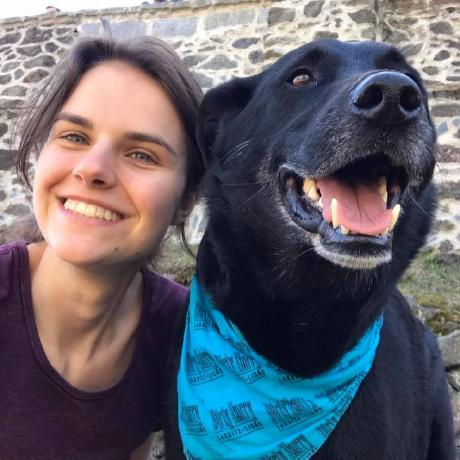
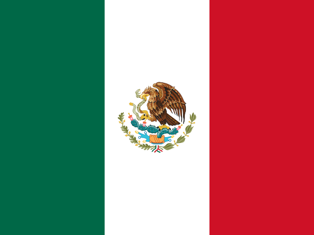
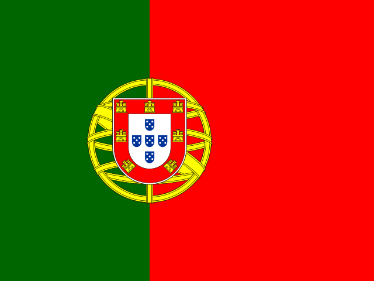
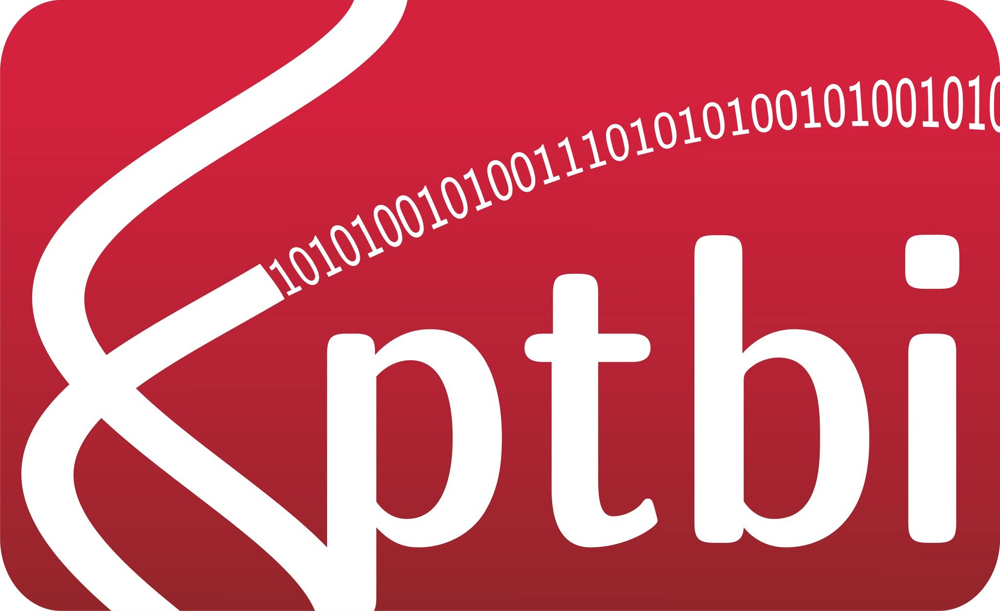
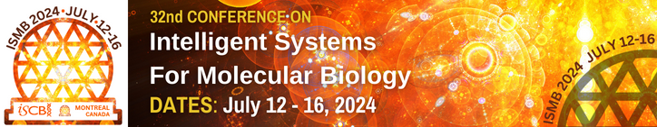
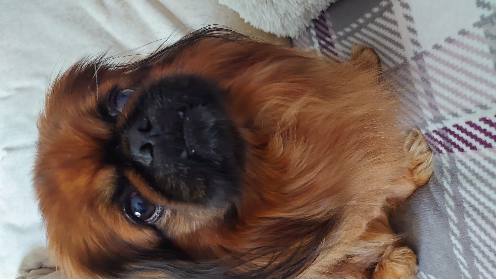
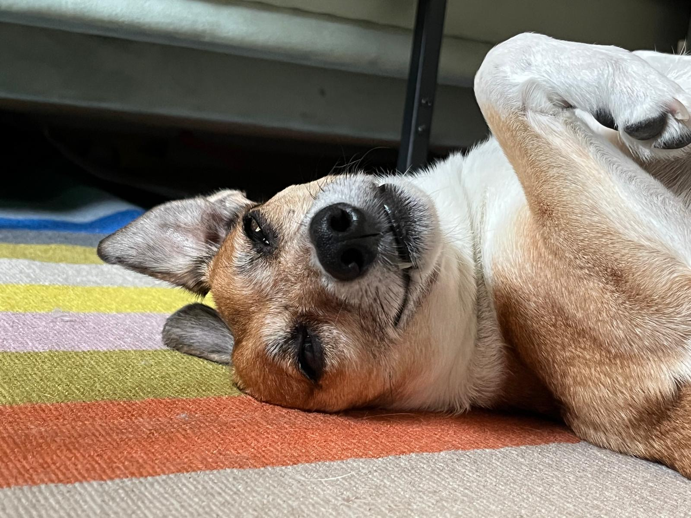

# People behind the science

Meet the BioGenies team: researchers working across bioinformatics, multiomics and machine learning. Explore their academic CVs, publications and collaborations.

Different backgrounds. Shared curiosity. We bring together biological questions, computational thinking and a collaborative spirit.

[Meet our collaborators](../subsite/colab.llms.md) · [Explore our research](../subsite/research.llms.md)

### [Laura Bąkała](team/lb.llms.md)

BioGenies

[Research profile ↗](team/lb.llms.md)

### [Michał Burdukiewicz](team/mb.llms.md)

Medical University of Białystok · Vilnius University

[Research profile ↗](team/mb.llms.md)

### [Jarosław (Jarek) Chilimoniuk](team/jc.llms.md)

Vilnius University · Medical University of Białystok

[Research profile ↗](team/jc.llms.md)

### [Krystyna (Krysia) Grzesiak](team/kg.llms.md)

University of Geneva · University of Wrocław

[Research profile ↗](team/kg.llms.md)

### [Valentín Iglesias](team/vi.llms.md)

Medical University of Białystok

[Research profile ↗](team/vi.llms.md)

### [Jakub Kołodziejczyk](team/jk.llms.md)

Google

[Research profile ↗](team/jk.llms.md)

### [Joanna Pokora](team/jp.llms.md)

University of Wrocław

[Research profile ↗](team/jp.llms.md)

### [Weronika Puchała](team/wp.llms.md)

Institute of Biochemistry and Biophysics, Polish Academy of Sciences

[Research profile ↗](team/wp.llms.md)

### [Mariia Rutkowska](team/mr.llms.md)

Medical University of Białystok

[Research profile ↗](team/mr.llms.md)

DW

### Damian Wilary

Medical University of Białystok

## A group in motion

Conferences, workshops and research stays connect our team and collaborators across institutions and borders. This overview summarises the activities recorded in our academic CVs.

**21** Countries in our records

**90** Conference & workshop editions

**28** Research stays

 Belgium  Canada  Cyprus  Czech Republic  Denmark  France  Germany  Greece  Hungary  Italy  Japan  Lithuania  Mexico  Netherlands  Poland  Portugal  Slovakia  Spain  Switzerland  United Kingdom  USA

### Meeting the research community

One card per event edition, with everyone who attended listed together. Includes current and former members and collaborators.

 logo")

2026-09-16 – 2026-09-18

### Symposium of the Polish Bioinformatics Society

 Poznań, Poland

Attended by [Michał Burdukiewicz](team/mb.llms.md) [Valentín Iglesias](team/vi.llms.md) [Krystyna (Krysia) Grzesiak](team/kg.llms.md) [Mariia Rutkowska](team/mr.llms.md)

Talks, posters & participation (4)

- **Michał Burdukiewicz ·** Talk

  European AI Act and biomedical data: more paperwork or more governance?

- **Valentín Iglesias ·** Talk

  The AmyloGraph amyloid-antibody database: data acquisition, curation, extraction for amyloid-antibody interactions

- **Krystyna (Krysia) Grzesiak ·** Talk

  Iscores: proper scoring rules for evaluating missing-value imputation methods

- **Mariia Rutkowska ·** Talk

  TickPacket

2026-02-17 – 2026-02-20

### Non-globular proteins in the era of Machine Learning Training School

 Seville, Spain

Attended by [Jarosław (Jarek) Chilimoniuk](team/jc.llms.md) [Julia Szkóp](colab/jsz.llms.md)

Talks, posters & participation (2)

- **Jarosław (Jarek) Chilimoniuk ·** Training

  Introduction to Machine learning for Non-globular proteins

- **Julia Szkóp ·** Training

  Introduction to Machine learning for Non-globular proteins

Event

2025-09-24 – 2025-09-26

### Functional Amyloid Meeting

 Hamburg, Germany

Attended by [Michał Burdukiewicz](team/mb.llms.md)

Talks, posters & participation (1)

- **Michał Burdukiewicz ·** Poster

  Aggregating amyloid resources

Earlier events (87)

2025 4

 logo")

2025-09-15 – 2025-09-17

### Symposium of the Polish Bioinformatics Society

 Białystok, Poland

Attended by [Michał Burdukiewicz](team/mb.llms.md) [Jarosław (Jarek) Chilimoniuk](team/jc.llms.md) [Valentín Iglesias](team/vi.llms.md) [Mariia Rutkowska](team/mr.llms.md) [Joanna (Asia) Pokora](team/jp.llms.md)

Talks, posters & participation (5)

- **Michał Burdukiewicz ·** Talk

  DeepSkim: Towards Automated Assessment of Publication Content

- **Jarosław (Jarek) Chilimoniuk ·** Poster

  Aggregating amyloid resources: comprehensive list of amyloid-like aggregation databases

- **Valentín Iglesias ·** Talk

  A4D Antibody Aggregation Database (A4D-ABDB): identifying and optimizing aggregation propensity for ttherapeutic antibodies

- **Mariia Rutkowska ·** Poster

  Development of AmyloGraph Antibody database

- **Joanna (Asia) Pokora ·** Poster

  MetaboCrates: An open-source pipeline for quality-aware analysis of targeted metabolomics data

Event

2025-09-15 – 2025-09-21

### Konferencja Zastosowań Matematyki

 Kościelisko, Poland

Attended by [Krystyna (Krysia) Grzesiak](team/kg.llms.md)

Talks, posters & participation (1)

- **Krystyna (Krysia) Grzesiak ·** Poster

  imputomics: how to impute metabolomics data

2025-06-22 – 2025-06-26

### Metabolomics

 Prague, Czech Republic

Attended by [Michał Burdukiewicz](team/mb.llms.md) [Krystyna (Krysia) Grzesiak](team/kg.llms.md) [Jarosław (Jarek) Chilimoniuk](team/jc.llms.md)

Talks, posters & participation (3)

- **Michał Burdukiewicz ·** Poster

  MetaboCrates: An open-source pipeline for quality-aware analysis of targeted metabolomics data

- **Krystyna (Krysia) Grzesiak ·** Poster

  Leveraging SLOPE Regularization for Variable Clustering in Metabolomics

- **Jarosław (Jarek) Chilimoniuk ·** Poster

  imputomics evolved: expanding imputation methods and redesigning benchmarks for missing data imputation

2025-05-20 – 2025-05-23

### Meeting on Non-globular proteins in the era of Machine Learning

 Vilnius, Lithuania

Attended by [Jarosław (Jarek) Chilimoniuk](team/jc.llms.md) [Valentín Iglesias](team/vi.llms.md) [Mariia Rutkowska](team/mr.llms.md) [Michał Burdukiewicz](team/mb.llms.md) [Oriol Bárcenas](colab/ob.llms.md)

Talks, posters & participation (5)

- **Jarosław (Jarek) Chilimoniuk ·** Poster

  Aggregating amyloid resources

- **Valentín Iglesias ·** Poster

  Liquid-liquid phase separation (LLPS) as a sensing and adaptation mechanism: An evidence-based hypothesis on AP2 transcription factors in the malaria parasite

- **Mariia Rutkowska ·** Poster

  Development of AmyloGraph Antibody database

- **Michał Burdukiewicz ·** Poster

  Comprehensive protein datasets and benchmarking for liquid-liquid phase separation

- **Oriol Bárcenas ·** Talk

  StriFi: Comprehensive database of Fibril Structures

2024 5

 logo")

2024-10-20 – 2024-10-24

### Human Proteome Organisation World Congress

 Dresden, Germany

Attended by [Weronika Puchała](team/wp.llms.md) [Jarosław (Jarek) Chilimoniuk](team/jc.llms.md) [Krystyna (Krysia) Grzesiak](team/kg.llms.md) [Oriol Bárcenas](colab/ob.llms.md) [Michał Burdukiewicz](team/mb.llms.md)

Talks, posters & participation (5)

- **Weronika Puchała ·** Poster

  hadexversum: tools for HDX-MS analysis

- **Jarosław (Jarek) Chilimoniuk ·** Poster

  imputomics 2.0: bridging data gaps in proteomics with missing value imputation algorithms and their benchmark

- **Krystyna (Krysia) Grzesiak ·** Poster

  Feature screening and model regularization for k-mer representations of biological sequences

- **Oriol Bárcenas ·** Poster

  Aggrescan4D: structure-informed analysis of pH-dependent protein aggregation

- **Michał Burdukiewicz ·** Poster

  Confident protein datasets for liquid-liquid phase separation studies

 logo")

2024-09-11 – 2024-09-13

### Symposium of the Polish Bioinformatics Society

 Warsaw, Poland

Attended by [Michał Burdukiewicz](team/mb.llms.md) [Jarosław (Jarek) Chilimoniuk](team/jc.llms.md) [Weronika Puchała](team/wp.llms.md) [Krystyna (Krysia) Grzesiak](team/kg.llms.md) [Katarzyna (Kasia) Sidorczuk](colab/ks.llms.md)

Talks, posters & participation (5)

- **Michał Burdukiewicz ·** Poster

  Confident datasets of client, driver and negative proteins in liquid-liquid phase separation

- **Jarosław (Jarek) Chilimoniuk ·** Poster

  imputomics 2.0: comprehensive R package for missing data imputation in proteomics data

- **Weronika Puchała ·** Poster

  hadexversum: HDX-MS analysis made easy

- **Krystyna (Krysia) Grzesiak ·** Poster

  Feature screening and model regularization for k-mer representations of biological sequences

- **Katarzyna (Kasia) Sidorczuk ·** Talk

  Strain-resolved metagenomics in analysis of gut microbiota dynamics within families

2024-07-12 – 2024-07-16

### Intelligent Systems For Molecular Biology

 Montreal, Canada

Attended by [Krystyna (Krysia) Grzesiak](team/kg.llms.md) [Weronika Puchała](team/wp.llms.md)

Talks, posters & participation (2)

- **Krystyna (Krysia) Grzesiak ·** Poster

  imputomics: web server and R package for missing values imputation in metabolomics data

- **Weronika Puchała ·** Poster

  hadexversum: the family of HDX-MS tools

2024-06-16 – 2024-06-20

### Metabolomics

 Osaka, Japan

Attended by [Krystyna (Krysia) Grzesiak](team/kg.llms.md)

Talks, posters & participation (1)

- **Krystyna (Krysia) Grzesiak ·** Poster

  Imputomics: Simplifying Metabolomics Data Imputation with All-in-One Access

2024-05-14 – 2024-05-17

### Meeting on Non-globular proteins in the era of Machine Learning

 Thessaloniki, Greece

Attended by [Jarosław (Jarek) Chilimoniuk](team/jc.llms.md) [Michał Burdukiewicz](team/mb.llms.md) [Valentín Iglesias](team/vi.llms.md)

Talks, posters & participation (3)

- **Jarosław (Jarek) Chilimoniuk ·** Poster

  imputomics 2.0: comprehensive R package for missing data imputation in proteomics data

- **Michał Burdukiewicz ·** Poster

  Confident dataset generation for the specific prediction and benchmarking of client, driver and negative proteins in liquid-liquid phase separation

- **Valentín Iglesias ·** Poster

  A3D Model Organism Database (A3D-MODB): a database for proteome aggregation predictions in model organisms.

2023 7

SCB

2023-12-15 – 2023-12-16

### Symposium of Bioinformatics and Genomics

 Barcelona, Spain

Attended by [Valentín Iglesias](team/vi.llms.md)

Talks, posters & participation (1)

- **Valentín Iglesias ·** Talk

  A3D Model Organism Database (A3D-MODB): a database for proteome aggregation predictions in model organisms.

PhasAge

2023-10-18 – 2023-10-20

### PhasAGE international conference

 Porto, Portugal

Attended by [Valentín Iglesias](team/vi.llms.md)

Talks, posters & participation (1)

- **Valentín Iglesias ·** Poster

  A3D Model Organism Database (A3D-MODB): a database for proteome aggregation predictions in model organisms.

IBID

2023-10-17 – 2023-10-19

### International Biotech Innovation Days

 Senftenberg, Germany

Attended by [Jarosław (Jarek) Chilimoniuk](team/jc.llms.md) [Michał Burdukiewicz](team/mb.llms.md)

Talks, posters & participation (2)

- **Jarosław (Jarek) Chilimoniuk ·** Talk

  Imputomics: comprehensive R package for missing data imputation in metabolomics data

- **Michał Burdukiewicz ·** Keynote

  AmyloGraph: mapping the landscape of amyloid-amyloid interactions

CASUS

2023-10-11

### Center for Advanced Systems Understanding workshops

 Wrocław, Poland

Attended by [Krystyna (Krysia) Grzesiak](team/kg.llms.md)

Talks, posters & participation (1)

- **Krystyna (Krysia) Grzesiak ·** Talk

  Imputomics: comprehensive missing value imputation for metabolomics data

2023-07-05 – 2023-07-07

### Meeting on Non-globular proteins in the era of Machine Learning

 Bratislava, Slovakia

Attended by [Valentín Iglesias](team/vi.llms.md) [Michał Burdukiewicz](team/mb.llms.md)

Talks, posters & participation (2)

- **Valentín Iglesias ·** Talk

  Incorporating protein microenvironmental influence on protein compaction prediction.

- **Michał Burdukiewicz ·** Talk

  AmyloGraph: A comprehensive database of amyloid-amyloid interactions

PhasAge

2023-04-17 – 2023-04-21

### PhasAGE training school

 Porto, Portugal

Attended by [Valentín Iglesias](team/vi.llms.md)

Talks, posters & participation (1)

- **Valentín Iglesias ·** Training

  Protein aggregation, intrinsic disorder and phase separation in the era of machine learning

MetCircle

2023-01-27 – 2023-01-28

### Metabolomics Circle

 Wrocław, Poland

Attended by [Jarosław (Jarek) Chilimoniuk](team/jc.llms.md)

Talks, posters & participation (1)

- **Jarosław (Jarek) Chilimoniuk ·** Talk

  Imputomics: imputation of missing values for ‘omics’ dat

2022 10

 logo")

2022-12-04 – 2022-12-08

### Human Proteome Organisation World Congress

 Cancún, Mexico

Attended by [Weronika Puchała](team/wp.llms.md)

Talks, posters & participation (1)

- **Weronika Puchała ·** Poster

DAaC

2022-11-24

### Hasso Plattner Institute, University of Potsdam

 Potsdam, Germany

Attended by [Michał Burdukiewicz](team/mb.llms.md)

Talks, posters & participation (1)

- **Michał Burdukiewicz ·** Keynote

  Sampling of negative datasets

CBaB

2022-11-16

### Faculty of Mathematics, Informatics, and Mechanics, University of Warsaw

 Warsaw, Poland

Attended by [Michał Burdukiewicz](team/mb.llms.md)

Talks, posters & participation (1)

- **Michał Burdukiewicz ·** Keynote

  The impact of negative data sampling on antimicrobial peptide prediction

ARgs

2022-11-11

### Institute of Biotechnology, Vilnius University

 Vilnius, Lithuania

Attended by [Michał Burdukiewicz](team/mb.llms.md)

Talks, posters & participation (1)

- **Michał Burdukiewicz ·** Keynote

  Pitfalls of machine learning for peptide analysis

Ptas

2022-10-27

### Faculty of Mathematics and Computer Science, University of Wrocław

 Wrocław, Poland

Attended by [Michał Burdukiewicz](team/mb.llms.md)

Talks, posters & participation (1)

- **Michał Burdukiewicz ·** Keynote

  Pułapki w analizie danych peptydowych

CASUS

2022-10-06 – 2022-10-07

### Center for Advanced Systems Understanding workshops

 Wrocław, Poland

Attended by [Krystyna (Krysia) Grzesiak](team/kg.llms.md)

Talks, posters & participation (1)

- **Krystyna (Krysia) Grzesiak ·** Talk

  A novel semiparametric model for hydrogen deuterium exchange monitored by mass spectrometry data

ECCB

2022-09-18 – 2022-09-21

### European Conference on Computational Biology

 Sitges, Spain

Attended by [Katarzyna (Kasia) Sidorczuk](colab/ks.llms.md)

Talks, posters & participation (1)

- **Katarzyna (Kasia) Sidorczuk ·**

  Where do they come from, where do they go? Prediction of protein subplastid localization and origin with PlastoGram

ESCS

2022-09-18

### European Student Council Symposium

 Sitges, Spain

Attended by [Katarzyna (Kasia) Sidorczuk](colab/ks.llms.md)

Talks, posters & participation (1)

- **Katarzyna (Kasia) Sidorczuk ·**

  Where do they come from, where do they go? Prediction of protein subplastid localization and origin with PlastoGram

GCB

2022-09-06 – 2022-09-08

### German Conference on Bioinformatics

 Halle (Salle), Germany

Attended by [Katarzyna (Kasia) Sidorczuk](colab/ks.llms.md)

Talks, posters & participation (1)

- **Katarzyna (Kasia) Sidorczuk ·**

  Where do they come from, where do they go? PlastoGram: a stacked model for prediction of protein subplastid localization and origin

CASUSCON

2022-07-11 – 2022-07-15

### UWr-HZDR-CASUS International Conference on Advanced Systems Research CASUSCON

 Wrocław, Poland

Attended by [Michał Burdukiewicz](team/mb.llms.md)

Talks, posters & participation (1)

- **Michał Burdukiewicz ·** Poster

  Differentation anticancer from antimicrobial pepides using Cancergram

2021 4

EYSF

2021-10-21 – 2021-10-22

### EMBO Young Scientists' Forum (EYSF)

 Warsaw, Poland

Attended by [Michał Burdukiewicz](team/mb.llms.md) [Katarzyna (Kasia) Sidorczuk](colab/ks.llms.md)

Talks, posters & participation (2)

- **Michał Burdukiewicz ·** Poster

  The impact of negative data sampling on antimicrobial peptides prediction

- **Katarzyna (Kasia) Sidorczuk ·** Poster

  CancerGram: How to differentiate anticancer from antimicrobial peptides?

GCB

2021-09-06 – 2021-09-09

### German Conference on Bioinformatics

online, Online

Attended by [Michał Burdukiewicz](team/mb.llms.md)

Talks, posters & participation (1)

- **Michał Burdukiewicz ·** Talk

  The impact of negative data sampling on antimicrobial peptide prediction

PCBBE

2021-05-19 – 2021-05-21

### Polish Conference on Biocybernetics and Biomedical Engineering

 Warsaw, Poland

Attended by [Michał Burdukiewicz](team/mb.llms.md)

Talks, posters & participation (1)

- **Michał Burdukiewicz ·** Poster

  Negative data set sampling as the source of bias in prediction of antimicrobial peptides

GfV

2021-03-24 – 2021-03-26

### Meeting of the Society for Virology

online, Online

Attended by [Michał Burdukiewicz](team/mb.llms.md)

Talks, posters & participation (1)

- **Michał Burdukiewicz ·** Poster

  AntiViroGram - proteome-wide prediction of antiviral peptide precursors

2020 4

IBID

2020-10-28 – 2020-10-29

### International Biotech Innovation Days

 Senftenberg, Germany

Attended by [Jarosław (Jarek) Chilimoniuk](team/jc.llms.md) [Katarzyna (Kasia) Sidorczuk](colab/ks.llms.md)

Talks, posters & participation (2)

- **Jarosław (Jarek) Chilimoniuk ·** Talk

  countfitteR: count data analysis for precision medicine

- **Katarzyna (Kasia) Sidorczuk ·** Poster

  Prediction of antimicrobial peptides with AmpGram

DSS

2020-10-16

### Data Science Summit

 Warsaw, Poland

Attended by [Katarzyna (Kasia) Sidorczuk](colab/ks.llms.md)

Talks, posters & participation (1)

- **Katarzyna (Kasia) Sidorczuk ·**

  Reproducible analytic workflows in R with drake and renv

2020-09-24 – 2020-09-27

### Why R? Conference

 Warszawa, Poland

Attended by [Jarosław (Jarek) Chilimoniuk](team/jc.llms.md)

Talks, posters & participation (1)

- **Jarosław (Jarek) Chilimoniuk ·** Talk

  Count data analysis with countfitteR

DGHM & VAAM

2020-03-08 – 2020-03-11

### Joint Microbiology & Infection Conference of the German Society for Hygiene and Microbiology and the Association of General and Applied Microbiology

 Leipzig, Germany

Attended by [Jarosław (Jarek) Chilimoniuk](team/jc.llms.md)

Talks, posters & participation (1)

- **Jarosław (Jarek) Chilimoniuk ·** Poster

  AmpGram – a novel tool for prediction of antimicrobial peptides

2019 13

SSP

2019-11-03 – 2019-11-06

### Symposium on Structural Proteomics

 Göttingen, Germany

Attended by [Weronika Puchała](team/wp.llms.md)

Talks, posters & participation (1)

- **Weronika Puchała ·** Poster

  HaDeX: tool for analysis of HDX-MS data

SSP

2019-11-03 – 2019-11-06

### Symposium on Structural Proteomics

 Gottingen, Germany

Attended by [Michał Burdukiewicz](team/mb.llms.md)

Talks, posters & participation (1)

- **Michał Burdukiewicz ·** Poster

  Just give me a p-value: statistical analysis of deuterium uptake curves in HDX-MS

2019-09-26 – 2019-09-29

### Why R? Conference

 Warszawa, Poland

Attended by [Weronika Puchała](team/wp.llms.md) [Katarzyna (Kasia) Sidorczuk](colab/ks.llms.md) [Jarosław (Jarek) Chilimoniuk](team/jc.llms.md) Dominik Rafacz

Talks, posters & participation (4)

- **Weronika Puchała ·** Talk

  R for experimentalists: HDX-MS example

- **Katarzyna (Kasia) Sidorczuk ·** Talk

  PepBay: Implementation of Bayesian inference in the analysis of peptide arrays

- **Jarosław (Jarek) Chilimoniuk ·** Talk

  AmyloGram: the R package and a Shiny server for amyloid prediction

- **Dominik Rafacz ·** Talk

  AmyloGram 2.0: MBO in the prediction of amyloid proteins

 logo")

2019-09-19 – 2019-09-21

### Symposium of the Polish Bioinformatics Society

 Cracow, Poland

Attended by Dominik Rafacz [Michał Burdukiewicz](team/mb.llms.md) [Katarzyna (Kasia) Sidorczuk](colab/ks.llms.md)

Talks, posters & participation (4)

- **Dominik Rafacz ·** Poster

  AmyloGram 2.0: MBO in the prediction of amyloid proteins

- **Dominik Rafacz ·** Talk

  AmyloGram 2.0: MBO in the prediction of amyloid proteins

- **Michał Burdukiewicz ·** Talk

  Did the targeting signals for mitochondria and plastids evolve from antimicrobial peptides?

- **Katarzyna (Kasia) Sidorczuk ·**

  In silico identification and phylogeny of components responsible for protein import into thylakoids of Paulinella photosynthetic species

 logo")

2019-09-19 – 2019-09-21

### Symposium of the Polish Bioinformatics Society

 Krakow, Poland

Attended by [Michał Burdukiewicz](team/mb.llms.md)

Talks, posters & participation (1)

- **Michał Burdukiewicz ·** Talk

  HaDeX: an R package and web-server for analysis of data from hydrogen-deuterium exchange mass spectrometry experiments

GCB

2019-09-17 – 2019-09-19

### German Conference on Bioinformatics

 Heidelberg, Germany

Attended by [Michał Burdukiewicz](team/mb.llms.md)

Talks, posters & participation (1)

- **Michał Burdukiewicz ·** Poster

  autobiogramML: towards automated machine learning in protein function prediction

IMSS

2019-09-15 – 2019-09-20

### International Mass Spectrometry School

 Sitges, Spain

Attended by [Weronika Puchała](team/wp.llms.md)

Talks, posters & participation (2)

- **Weronika Puchała ·** Poster

  HaDeX - web-server for analysis of data from hydrogen-deuterium exchange-mass spectrometry experiments

- **Weronika Puchała ·** Talk

  HaDeX - web-server for analysis of data from hydrogen-deuterium exchange-mass spectrometry experiments

EMBO \| EMBL

2019-09-11 – 2019-09-13

### Symposium: Multiomics to Mechanisms - Challenges in Data Integration

 Heidelberg, Germany

Attended by [Weronika Puchała](team/wp.llms.md)

Talks, posters & participation (1)

- **Weronika Puchała ·** Poster

  Analysis of data from hydrogen-deuterium exchange mass spectrometry experiments

, conference organiser logo")

2019-07-21 – 2019-07-25

### Intelligent Systems For Molecular Biology and the European Conference on Computational Biology

 Basel, Switzerland

Attended by [Weronika Puchała](team/wp.llms.md)

Talks, posters & participation (1)

- **Weronika Puchała ·** Poster

  HaDeX - analysis of data from hydrogen-deuterium exchange-mass spectrometry experiments

SMBE

2019-07-21 – 2019-07-25

### Meeting of the Society for Molecular Biology and Evolution

 Manchester, United Kingdom

Attended by [Michał Burdukiewicz](team/mb.llms.md)

Talks, posters & participation (1)

- **Michał Burdukiewicz ·** Poster

  Did the targeting signals for mitochondria and plastids evolve from ancient antimicrobial peptides?

SatRday

2019-05-17 – 2019-05-18

### Conference for users of the R Language

 Gdańsk, Poland

Attended by [Weronika Puchała](team/wp.llms.md) [Katarzyna (Kasia) Sidorczuk](colab/ks.llms.md) [Jarosław (Jarek) Chilimoniuk](team/jc.llms.md) Dominik Rafacz [Michał Burdukiewicz](team/mb.llms.md)

Talks, posters & participation (5)

- **Weronika Puchała ·** Talk

  HaDeX - analysis of HDX-MS data

- **Katarzyna (Kasia) Sidorczuk ·** Talk

  Bayesian inference in big data analysis

- **Jarosław (Jarek) Chilimoniuk ·** Talk

  AmyloGram: prediction of amyloid sequences in R

- **Dominik Rafacz ·** Talk

  drake: reproducible workflow management in R

- **Michał Burdukiewicz ·** Talk

  predPCR: an automated classification of qPCR curves

EuPA

2019-03-24 – 2019-03-28

### Congress of the European Proteomic Association

 Potsdam, Germany

Attended by [Jarosław (Jarek) Chilimoniuk](team/jc.llms.md)

Talks, posters & participation (1)

- **Jarosław (Jarek) Chilimoniuk ·** Poster

  AmyloGram: prediction of amyloid sequences in R

VAAM

2019-03-17 – 2019-03-19

### Conference of the Association for General and Applied Microbiology

 Mainz, Germany

Attended by [Jarosław (Jarek) Chilimoniuk](team/jc.llms.md)

Talks, posters & participation (1)

- **Jarosław (Jarek) Chilimoniuk ·** Poster

  Co-evolution of curli components CsgA and CsgB

2018 10

PL in ML

2018-12-14 – 2018-12-17

### Polish View on Machine Learning

 Warsaw, Poland

Attended by [Katarzyna (Kasia) Sidorczuk](colab/ks.llms.md) [Jarosław (Jarek) Chilimoniuk](team/jc.llms.md) [Michał Burdukiewicz](team/mb.llms.md)

Talks, posters & participation (4)

- **Katarzyna (Kasia) Sidorczuk ·** Poster

  PepBay: a Bayesian framework for analysis of peptide arrays

- **Jarosław (Jarek) Chilimoniuk ·** Poster

  AmyloGram: prediction of amyloid sequences in R

- **Michał Burdukiewicz ·** Poster

  PCRedux: machine learning helper tool for sigmoid curves

- **Michał Burdukiewicz ·** Poster

  PCRedux: machine learning helper tool for sigmoid curves

ASM

2018-10-07 – 2018-10-11

### American Society for Microbiology Conference on Biofilms

 Washington DC, USA

Attended by [Jarosław (Jarek) Chilimoniuk](team/jc.llms.md)

Talks, posters & participation (1)

- **Jarosław (Jarek) Chilimoniuk ·** Poster

  CsgA, CsgB and CsgC - evolutionary Interplay in curli biogenesis

NGP-Net

2018-09-12 – 2018-09-14

### NGP-Net Symposium on non-globular proteins

 Druskininkai, Lithuania

Attended by [Valentín Iglesias](team/vi.llms.md)

Talks, posters & participation (1)

- **Valentín Iglesias ·** Talk

  Evaluation of mutational impact on prion-like proteins aggregation propensity.

 logo")

2018-09-05 – 2018-09-07

### Symposium of the Polish Bioinformatics Society

 Wrocław, Poland

Attended by [Jarosław (Jarek) Chilimoniuk](team/jc.llms.md) [Michał Burdukiewicz](team/mb.llms.md) [Katarzyna (Kasia) Sidorczuk](colab/ks.llms.md)

Talks, posters & participation (3)

- **Jarosław (Jarek) Chilimoniuk ·** Talk

  PhyMet2: a database and toolkit for phylogenetic and metabolic analyses of methanogens

- **Michał Burdukiewicz ·** Talk

  predPCR: automated classification of sigmoid curves

- **Katarzyna (Kasia) Sidorczuk ·** Poster

  Two protein import pathways into the cyanobacteria-derived, photosynthetic organelles of Paulinella chromatophora

IBID

2018-05-23 – 2018-05-25

### International Biotech Innovation Days

 Senftenberg, Germany

Attended by [Jarosław (Jarek) Chilimoniuk](team/jc.llms.md) [Katarzyna (Kasia) Sidorczuk](colab/ks.llms.md) [Michał Burdukiewicz](team/mb.llms.md)

Talks, posters & participation (3)

- **Jarosław (Jarek) Chilimoniuk ·** Poster

  PhyMet2: database and algorithm predicting culturing conditions of methanogens

- **Katarzyna (Kasia) Sidorczuk ·** Poster

  Protein import into the chromatophores of Paulinella photosynthetic species

- **Michał Burdukiewicz ·** Workshops

  Introduction to basic R

MRCL

2018-05-01

### University of Michigan

 Michigan, USA

Attended by [Michał Burdukiewicz](team/mb.llms.md)

Talks, posters & participation (1)

- **Michał Burdukiewicz ·** Keynote

  Amyloid stretches in proteinous scaffolds of biofilms

VAAM

2018-04-15 – 2018-04-18

### Conference of the Association for General and Applied Microbiology

 Wolfsburg, Germany

Attended by [Jarosław (Jarek) Chilimoniuk](team/jc.llms.md)

Talks, posters & participation (1)

- **Jarosław (Jarek) Chilimoniuk ·** Poster

  PhyMet2: complex database containing records on methanogens with unique feature (MethanoGram) allowing prediction of culture conditions based on 16S rRNA

NGP-Net

2018-04-09 – 2018-04-12

### NGP-Net Symposium on non-globular proteins

 Budapest, Hungary

Attended by [Valentín Iglesias](team/vi.llms.md)

Talks, posters & participation (1)

- **Valentín Iglesias ·** Training

SiL

2018-01-24

### Interdisciplinary Nanoscience Center & Department of Molecular Biology and Genetics, Aarhus University

 Aarhus, Denmark

Attended by [Michał Burdukiewicz](team/mb.llms.md)

Talks, posters & participation (1)

- **Michał Burdukiewicz ·** Keynote

  Challenges in the computational prediction of peptide amyloidogenicity

NGP-Net

2018-01-09 – 2018-01-12

### NGP-Net Winter School on non-globular proteins

 Nicossia, Cyprus

Attended by [Valentín Iglesias](team/vi.llms.md)

Talks, posters & participation (1)

- **Valentín Iglesias ·** Training

2017 7

SCB

2017-12-20

### Symposium of Bioinformatics and Genomics

 Barcelona, Spain

Attended by [Valentín Iglesias](team/vi.llms.md)

Talks, posters & participation (1)

- **Valentín Iglesias ·** Poster

  AMYCO: Evaluation of mutational impact on prion-like proteins aggregation propensity.

WBS

2017-10-09 – 2017-10-10

### Wrocław Biofilm Symposium

 Wrocław, Poland

Attended by [Michał Burdukiewicz](team/mb.llms.md)

Talks, posters & participation (1)

- **Michał Burdukiewicz ·** Talk

  Predicting properties of biological sequences using n-gram analysis

NGP-Net

2017-08-28 – 2017-09-01

### NGP-Net Symposium on non-globular proteins

 Košice, Slovakia

Attended by [Michał Burdukiewicz](team/mb.llms.md)

Talks, posters & participation (1)

- **Michał Burdukiewicz ·** Talk

  Challenges in the computational prediction of peptide amyloidogenicity

, conference organiser logo")

2017-07-21 – 2017-07-25

### Intelligent Systems For Molecular Biology and the European Conference on Computational Biology

 Prague, Czech Republic

Attended by [Michał Burdukiewicz](team/mb.llms.md)

Talks, posters & participation (1)

- **Michał Burdukiewicz ·** Poster

  Computational and experimental validation of amyloid databases

useR!

2017-07-04 – 2017-07-07

### useR!

 Brussels, Belgium

Attended by [Michał Burdukiewicz](team/mb.llms.md)

Talks, posters & participation (2)

- **Michał Burdukiewicz ·** Poster

  AmyloGram: prediction of amyloid sequences in R

- **Michał Burdukiewicz ·** Poster

  Integrated analysis of digital PCR experiments in R

IA„A

2017-05-25

### Brandenburg University of Technology Cottbus-Senftenberg

 Senftenberg, Germany

Attended by [Michał Burdukiewicz](team/mb.llms.md)

Talks, posters & participation (1)

- **Michał Burdukiewicz ·** Keynote

  Modelling amyloidogenic scaffolds of biofilms

qPCR dPCR & NGS

2017-04-03 – 2017-04-05

### qPCR dPCR & NGS

 Freising, Germany

Attended by [Michał Burdukiewicz](team/mb.llms.md)

Talks, posters & participation (1)

- **Michał Burdukiewicz ·** Talk

  dpcReport: web server and software suite for unified analysis of digital PCRs and digital assays

2016 12

SCB

2016-12-20

### Symposium of Bioinformatics and Genomics

 Barcelona, Spain

Attended by [Valentín Iglesias](team/vi.llms.md)

Talks, posters & participation (1)

- **Valentín Iglesias ·** Poster

  PrionW: a server to identify proteins containing glutamine/asparagine rich prion-like domains and their amyloid cores.

eRum

2016-10-12 – 2016-10-14

### European R Users Meeting

 Poznań, Poland

Attended by [Michał Burdukiewicz](team/mb.llms.md)

Talks, posters & participation (1)

- **Michał Burdukiewicz ·** Poster

  N-gram analysis of biological sequences in R

 logo")

2016-09-28 – 2016-09-30

### Symposium of the Polish Bioinformatics Society

 Białystok, Poland

Attended by [Michał Burdukiewicz](team/mb.llms.md)

Talks, posters & participation (1)

- **Michał Burdukiewicz ·** Talk

  SignalHsmm: prediction of malarial signal peptides

BIO

2016-09-13 – 2016-09-16

### Congress of the Polish Biochemistry, Cell Biology, Biophysics and Bioinformatics

 Wrocław, Poland

Attended by [Michał Burdukiewicz](team/mb.llms.md)

Talks, posters & participation (1)

- **Michał Burdukiewicz ·** Poster

  AmyloGram: analysis and prediction of amyloids using n-grams

GCB

2016-09-12 – 2016-09-15

### German Conference on Bioinformatics

 Berlin, Germany

Attended by [Michał Burdukiewicz](team/mb.llms.md)

Talks, posters & participation (1)

- **Michał Burdukiewicz ·** Talk

  Prediction of malarial signal peptides

ECCB

2016-09-03 – 2016-09-07

### European Conference on Computational Biology

 Hague, Netherlands

Attended by [Michał Burdukiewicz](team/mb.llms.md)

Talks, posters & participation (1)

- **Michał Burdukiewicz ·** Talk

  AmyloGram: a novel predictor of amyloidogenicity

ESCS

2016-09-03

### European Student Council Symposium

 Hague, Netherlands

Attended by [Michał Burdukiewicz](team/mb.llms.md)

Talks, posters & participation (1)

- **Michał Burdukiewicz ·** Poster

  AmyloGram: a novel predictor of amyloidogenicity

CHARME

2016-06-21 – 2016-06-22

### CHARME of standardisation in life sciences

 Warsaw, Poland

Attended by [Michał Burdukiewicz](team/mb.llms.md)

Talks, posters & participation (1)

- **Michał Burdukiewicz ·** Poster

  Biogram: standardization of biological n-gram analysis in R

BIT

2016-06-16 – 2016-06-18

### BioInformatics in Toruń

 Toruń, Poland

Attended by [Michał Burdukiewicz](team/mb.llms.md)

Talks, posters & participation (1)

- **Michał Burdukiewicz ·** Poster

  AmyloGram: n-gram analysis of amyloids

IBID

2016-06-01 – 2016-06-02

### Innovation Forum Senftenberg

 Senftenberg, Germany

Attended by [Michał Burdukiewicz](team/mb.llms.md)

Talks, posters & participation (2)

- **Michał Burdukiewicz ·** Poster

  dpcR: web server and R package for analysis of digital PCR experiments

- **Michał Burdukiewicz ·** Talk

  biogram: a toolkit for biological n-gram analysis

NGP-Net

2016-02-15 – 2016-02-19

### NGP-Net Winter School on non-globular proteins

 Brixen, Italy

Attended by [Valentín Iglesias](team/vi.llms.md)

Talks, posters & participation (1)

- **Valentín Iglesias ·** Training

BIFI

2016-02-01 – 2016-02-03

### International Conference BIFI 2016 on Molecular Recognition

 Zaragoza, Spain

Attended by [Valentín Iglesias](team/vi.llms.md)

Talks, posters & participation (1)

- **Valentín Iglesias ·** Talk

  PrionW: a server to identify proteins containing glutamine/asparagine rich prion-like domains and their amyloid cores.

2015 5

Potsdam Days

2015-11-01 – 2015-11-02

### Potsdam Days on Bioanalysis

 Potsdam, Germany

Attended by [Michał Burdukiewicz](team/mb.llms.md)

Talks, posters & participation (1)

- **Michał Burdukiewicz ·** Poster

  dpcReport -- Mobile-Health analysis framework

GCB

2015-09-27 – 2015-09-30

### German Conference on Bioinformatics

 Dortmund, Germany

Attended by [Michał Burdukiewicz](team/mb.llms.md)

Talks, posters & participation (1)

- **Michał Burdukiewicz ·** Poster

  N-gram analysis of amyloid data

 logo")

2015-09-17 – 2015-09-19

### Symposium of the Polish Bioinformatics Society

 Lublin, Poland

Attended by [Michał Burdukiewicz](team/mb.llms.md)

Talks, posters & participation (1)

- **Michał Burdukiewicz ·** Poster

  biogram: a toolkit for n-gram analysis

RECOMB

2015-04-12 – 2015-04-15

### International Conference on Research in Computational Molecular Biology

 Warsaw, Poland

Attended by [Michał Burdukiewicz](team/mb.llms.md)

Talks, posters & participation (1)

- **Michał Burdukiewicz ·** Poster

  Predicting eukaryotic signal peptides using hidden Markov models

qPCR dPCR & NGS

2015-03-23 – 2015-03-27

### qPCR dPCR & NGS

 Freising-Weihenstephan, Germany

Attended by [Michał Burdukiewicz](team/mb.llms.md)

Talks, posters & participation (2)

- **Michał Burdukiewicz ·** Poster

  The dpcR Package – a Framework for Analysis and Visualization of Digital PCR Experiments

- **Michał Burdukiewicz ·** Poster

  Methods of Comparing Digital PCR Experiments

2014 4

IMB - Seminar

2014-10-09

### Technical University Dresden

 Dresden, Germany

Attended by [Michał Burdukiewicz](team/mb.llms.md)

Talks, posters & participation (1)

- **Michał Burdukiewicz ·** Keynote

  Prediction of eukaryotic signal peptides using hidden semi-Markov models

DGHM & VAAM

2014-10-05 – 2014-10-08

### Joint Microbiology & Infection Conference of the German Society for Hygiene and Microbiology and the Association of General and Applied Microbiology

 Dresden, Germany

Attended by [Michał Burdukiewicz](team/mb.llms.md)

Talks, posters & participation (1)

- **Michał Burdukiewicz ·** Poster

  Prevalence of Shiga toxin-producing, enterohemorrhagic and enteropathogenic Escherichia coli – a systematic review

BIO

2014-09-09 – 2014-09-12

### Congress of the Polish Biochemistry, Cell Biology, Biophysics and Bioinformatics

 Warsaw, Poland

Attended by [Michał Burdukiewicz](team/mb.llms.md)

Talks, posters & participation (1)

- **Michał Burdukiewicz ·** Talk

  Signal peptide prediction using hidden Markov models

qPCR dPCR & NGS

2014-09-09 – 2014-09-10

### qPCR dPCR & NGS

 Lyon, France

Attended by [Michał Burdukiewicz](team/mb.llms.md)

Talks, posters & participation (1)

- **Michał Burdukiewicz ·** Poster

  dpcR: an R package for the analysis of digital PCR

Undated 2

Event

ongoing

### BioHackaton

 Berlin, Germany

Attended by [Michał Burdukiewicz](team/mb.llms.md)

Talks, posters & participation (1)

- **Michał Burdukiewicz ·** Workshops

Event

ongoing

### 4th BioHackaton

 Wals, Germany

Attended by [Valentín Iglesias](team/vi.llms.md)

Talks, posters & participation (1)

- **Valentín Iglesias ·** Workshops

  Data Extraction and Annotation of Amyloid-Antibody Interactions: What We Built, What We Broke, Where We Stand, and What We’ve Learned

### Research stays & exchanges

2024-11-12 – 2025-07-11

**Medical University of Białystok**

Mariia Rutkowska

 Białystok, Poland

Laboratory of Bioinformatics and Multi-omics Analysis

2024-10-01 – 2025-02-10

**Medical University of Białystok**

Ronja Tittel

 Białystok, Poland

Laboratory of Bioinformatics and Multi-omics Analysis

2024-04-01 – 2024-10-01

**BoneLab Dresden**

Mariia Rutkowska

 Dresden, Germany

OsteoHematology

Earlier research stays (25)

2024 1

2024-01-15 – 2024-01-23

**Universitat Autònoma de Barcelona**

Jarosław (Jarek) Chilimoniuk

 Barcelona, Spain

Protein Folding and Conformational Diseases

2023 2

2023-05-13 – 2023-05-27

**Universitat Autònoma de Barcelona**

Jarosław (Jarek) Chilimoniuk

 Barcelona, Spain

Protein Folding and Conformational Diseases

2023-01-16 – 2023-01-23

**Universitat Autònoma de Barcelona**

Jarosław (Jarek) Chilimoniuk

 Barcelona, Spain

Protein Folding and Conformational Diseases

2022 4

2022-12-05 – 2022-12-24

**Vilnius University**

Jarosław (Jarek) Chilimoniuk

 Vilnius, Lithuania

Group of Amyloid Research

2022-05-01 – ongoing

**Universitat Autònoma de Barcelona**

Michał Burdukiewicz

 Barcelona, Spain

Protein Folding and Conformational Diseases

2022-02-15 – 2023-12-14

**Institute for Bioengineering of Catalonia**

Valentín Iglesias

 Barcelona, Spain

Nanomalaria

2022-02-15 – 2023-12-14

**Barcelona Institute for Global Health**

Valentín Iglesias

 Barcelona, Spain

Nanomalaria

2021 1

2021-11-01 – 2021-12-26

**Brandenburg University of Technology Cottbus-Senftenberg**

Jarosław (Jarek) Chilimoniuk

 Senftenberg, Germany

Multiparameter Diagnostic

2020 2

2020-10-01 – 2021-09-30

**Brandenburg University of Technology Cottbus-Senftenberg**

Jarosław (Jarek) Chilimoniuk

 Senftenberg, Germany

Multiparameter Diagnostic

2020-03-01 – 2020-05-29

**Brandenburg University of Technology Cottbus-Senftenberg**

Jarosław (Jarek) Chilimoniuk

 Senftenberg, Germany

Multiparameter Diagnostic

2019 4

2019-07-01 – 2019-07-15

**Warsaw University of Technology**

Jarosław (Jarek) Chilimoniuk

 Warsaw, Poland

MI2 DataLab

2019-07-01 – 2019-12-16

**Brandenburg University of Technology Cottbus-Senftenberg**

Jarosław (Jarek) Chilimoniuk

 Senftenberg, Germany

Multiparameter Diagnostic

2019-04-15 – 2019-05-31

**Brandenburg University of Technology Cottbus-Senftenberg**

Jarosław (Jarek) Chilimoniuk

 Senftenberg, Germany

Multiparameter Diagnostic

2019-02-04 – 2019-02-15

**Brandenburg University of Technology Cottbus-Senftenberg**

Jarosław (Jarek) Chilimoniuk

 Senftenberg, Germany

Multiparameter Diagnostic

2018 4

2018-11-02 – 2018-11-09

**Vilnius University**

Jarosław (Jarek) Chilimoniuk

 Vilnius, Lithuania

Group of Amyloid Research

2018-05-01 – 2018-05-31

**University of Michigan**

Michał Burdukiewicz

 Michigan, USA

Chapman Lab

2018-04-01 – 2018-09-30

**Brandenburg University of Technology Cottbus-Senftenberg**

Jarosław (Jarek) Chilimoniuk

 Senftenberg, Germany

Image Based Assays

2018-01-07 – 2018-01-26

**Vilnius University**

Jarosław (Jarek) Chilimoniuk

 Vilnius, Lithuania

Group of Amyloid Research

2017 3

2017-10-30 – 2017-02-27

**Università degli Studi di Padova**

Valentín Iglesias

 Padova, Italy

BioComputing UP

2017-10-01 – 2018-03-31

**Denmark Technical University**

Michał Burdukiewicz

 Copenhagen, Denmark

Protein Sorting

2017-02-01 – 2017-02-28

**Denmark Technical University**

Michał Burdukiewicz

 Copenhagen, Denmark

Center for Biological Sequence Analysis

2016 1

2016-03-01 – 2014-04-30

**Brandenburg University of Technology Cottbus-Senftenberg**

Michał Burdukiewicz

 Senftenberg, Germany

InnoProfile Research Group

2015 1

2015-07-01 – 2015-08-30

**Brandenburg University of Technology Cottbus-Senftenberg**

Michał Burdukiewicz

 Senftenberg, Germany

InnoProfile Research Group

2014 1

2014-06-01 – 2014-09-30

**Technical University Dresden**

Michał Burdukiewicz

 Dresden, Germany

2013 1

2013-07-01 – 2013-09-30

**Brandenburg University of Technology Cottbus-Senftenberg**

Michał Burdukiewicz

 Senftenberg, Germany

InnoProfile Research Group

## The extended team

Our four-legged colleagues, and an important part of life around the lab.

Czarek

Delma

Piksel

Invi

Lusia

Elis
