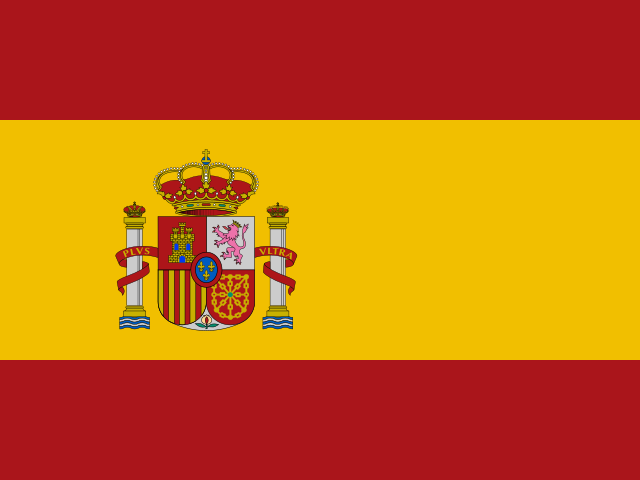
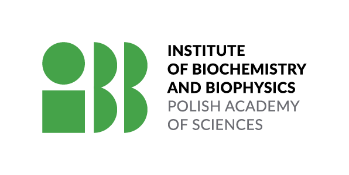
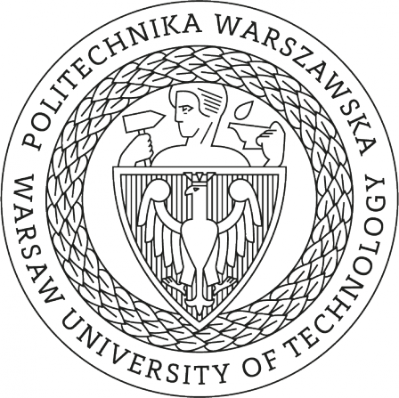

# Michał Burdukiewicz

Research profile and academic CV of Michał Burdukiewicz: publications, experience, education and BioGenies news.

## Biography

Hi! My name is Michał Burdukiewicz and I am passionate about bioinformatics and R.

I am currently leading the Laboratory of Bioinformatics and Multi-omics Analysis at the Medical University of Białystok. Contact me if you want to collaborate with us!

My current projects:

- [AmyloGraph](https://amylograph.com), a comprehensive database of amyloid-amyloid interactions ([doi:10.1093/nar/gkac882](https://doi.org/10.1093/nar/gkac882)).
- [HaDeX](https://github.com/hadexversum), an integrated analytical tool for HDX-MS (maintainer [Weronika Puchała](https://github.com/werpuc)).
- [Negative data sampling](http://biogenies.info/NegativeDatasets/), where we show that benchmarks in antimicrobial peptide prediction are biased due to the selection of negative data ([doi:10.1093/bib/bbac343](https://doi.org/10.1093/bib/bbac343)).

I am also maintaining the list of [machine learning models for prediction of peptide properties](http://biogenies.info/peptide-prediction-list/) (see also our [article on that](https://doi.org/10.1016/j.csbj.2022.11.043)).

I ❤️ [R](https://cran.r-project.org/)!

## Contact

[Email](mailto:michal.burdukiewicz@umb.edu.pl) [GitHub](https://github.com/michbur) [ORCID](https://orcid.org/0000-0001-8926-582X) [LinkedIn](https://www.linkedin.com/in/michal-burdukiewicz/) [X](https://x.com/burdukiewicz)

## Research stays

2022-05-01 – ongoing

### Protein Folding and Conformational Diseases

Institute of Biotechnology and Biomedicine · Universitat Autònoma de Barcelona · Barcelona · Spain

 Barcelona, Spain

2018-05-01 – 2018-05-31

### Chapman Lab

Molecular, Cellular and Developmental Biology · University of Michigan · Michigan · USA

 Michigan, USA

2017-10-01 – 2018-03-31

### Protein Sorting

Department of Bio and Health Informatics · Denmark Technical University · Copenhagen · Denmark

 Copenhagen, Denmark

Earlier records (5)

2017 1

2017-02-01 – 2017-02-28

### Center for Biological Sequence Analysis

Department of Systems Biology · Denmark Technical University · Copenhagen · Denmark

 Copenhagen, Denmark

2016 1

2016-03-01 – 2014-04-30

### InnoProfile Research Group

Institute of Biotechnology · Brandenburg University of Technology Cottbus-Senftenberg · Senftenberg · Germany

 Senftenberg, Germany

2015 1

2015-07-01 – 2015-08-30

### InnoProfile Research Group

Institute of Biotechnology · Brandenburg University of Technology Cottbus-Senftenberg · Senftenberg · Germany

 Senftenberg, Germany

2014 1

2014-06-01 – 2014-09-30

### Institute for Medical Informatics and Biometry

Technical University Dresden · Dresden · Germany

 Dresden, Germany

2013 1

2013-07-01 – 2013-09-30

### InnoProfile Research Group

Institute of Biotechnology · Brandenburg University of Technology Cottbus-Senftenberg · Senftenberg · Germany

 Senftenberg, Germany

## Experience

2024-09-01 – ongoing

### Senior researcher

Amyloid research sector · Life Sciences Centre · Vilnius University

 Vilnius, Lithuania

2024-05-01 – ongoing

### Assistant professor \| Group leader

Bioinformatics and Multiomics Analysis Laboratory · Clinical Research Centre · Medical University of Białystok

 Białystok, Poland

2022-05-01 – ongoing

### Post-doc (Maria Zambrano)

Protein Folding and Conformational Diseases · Institute of Biotechnology and Biomedicine · Autonomous University of Barcelona

 Barcelona, Spain

Earlier records (6)

2021 1

2021-11-01 – 2022-09-30

### Senior bioinformatician

National Institute of Public Heath NIH National Research Institute

 Warsaw, Poland

2020 2

2020-12-14 – 2024-04-30

### Assistant professor

Metabolomics Laboratory · Clinical Research Centre · Medical University of Białystok

 Białystok, Poland

2020-10-01 – 2021-06-30

### Post-doc

Laboratory of Mass Spectrometry · Institute of Biochemistry and Biophysics

 Warsaw, Poland

2019 1

2019-06-01 – 2021-09-30

### Founder and CEO

.prot

 Warsaw, Poland

2018 2

2018-10-01 – 2020-10-30

### Adjunct professor

Warsaw University of Technology

 Warsaw, Poland

2018-02-01 – 2023-10-30

### Founder and board member

Why R? Foundation

 Warsaw, Poland

## Education

2015 – 2019  University of Wrocław PhD

 Wrocław, Poland

Molecular biology

**Thesis:** n-gram analysis of biological sequences

2015-10-01 – 2019-01-15 · Wrocław, Poland

2011 – 2013  University of Wrocław MSc

 Wrocław, Poland

Bioinformatics and systems biology

**Thesis:** Machine learning algorithms in prediction of signal peptides of heterokonts

2011-10-01 – 2013-06-15 · Wrocław, Poland

## Conferences, workshops and training

55 conference and training events

PTBI

2026-09-16 – 2026-09-18

### Symposium of the Polish Bioinformatics Society

 Poznań, Poland

Talks, posters & participation (1)

- Talk

  European AI Act and biomedical data: more paperwork or more governance?

Event

2025-09-24 – 2025-09-26

### Functional Amyloid Meeting

 Hamburg, Germany

Talks, posters & participation (1)

- Poster

  Aggregating amyloid resources

PTBI

2025-09-15 – 2025-09-17

### Symposium of the Polish Bioinformatics Society

 Białystok, Poland

Talks, posters & participation (1)

- Talk

  DeepSkim: Towards Automated Assessment of Publication Content

Earlier activities (52)

2025 2

Metabolomics

2025-06-22 – 2025-06-26

### Metabolomics

 Prague, Czech Republic

Talks, posters & participation (1)

- Poster

  MetaboCrates: An open-source pipeline for quality-aware analysis of targeted metabolomics data

2025-05-20 – 2025-05-23

### Meeting on Non-globular proteins in the era of Machine Learning

 Vilnius, Lithuania

Talks, posters & participation (1)

- Poster

  Comprehensive protein datasets and benchmarking for liquid-liquid phase separation

2024 3

HUPO

2024-10-20 – 2024-10-24

### Human Proteome Organisation World Congress

 Dresden, Germany

Talks, posters & participation (1)

- Poster

  Confident protein datasets for liquid-liquid phase separation studies

PTBI

2024-09-11 – 2024-09-13

### Symposium of the Polish Bioinformatics Society

 Warsaw, Poland

Talks, posters & participation (1)

- Poster

  Confident datasets of client, driver and negative proteins in liquid-liquid phase separation

2024-05-14 – 2024-05-17

### Meeting on Non-globular proteins in the era of Machine Learning

 Thessaloniki, Greece

Talks, posters & participation (1)

- Poster

  Confident dataset generation for the specific prediction and benchmarking of client, driver and negative proteins in liquid-liquid phase separation

2023 2

IBID

2023-10-17 – 2023-10-19

### International Biotech Innovation Days

 Senftenberg, Germany

Talks, posters & participation (1)

- Keynote

  AmyloGraph: mapping the landscape of amyloid-amyloid interactions

2023-07-05 – 2023-07-07

### Meeting on Non-globular proteins in the era of Machine Learning

 Bratislava, Slovakia

Talks, posters & participation (1)

- Talk

  AmyloGraph: A comprehensive database of amyloid-amyloid interactions

2022 5

DAaC

2022-11-24

### Hasso Plattner Institute, University of Potsdam

 Potsdam, Germany

Talks, posters & participation (1)

- Keynote

  Sampling of negative datasets

CBaB

2022-11-16

### Faculty of Mathematics, Informatics, and Mechanics, University of Warsaw

 Warsaw, Poland

Talks, posters & participation (1)

- Keynote

  The impact of negative data sampling on antimicrobial peptide prediction

ARgs

2022-11-11

### Institute of Biotechnology, Vilnius University

 Vilnius, Lithuania

Talks, posters & participation (1)

- Keynote

  Pitfalls of machine learning for peptide analysis

Ptas

2022-10-27

### Faculty of Mathematics and Computer Science, University of Wrocław

 Wrocław, Poland

Talks, posters & participation (1)

- Keynote

  Pułapki w analizie danych peptydowych

CASUSCON

2022-07-11 – 2022-07-15

### UWr-HZDR-CASUS International Conference on Advanced Systems Research CASUSCON

 Wrocław, Poland

Talks, posters & participation (1)

- Poster

  Differentation anticancer from antimicrobial pepides using Cancergram

2021 4

EYSF

2021-10-21 – 2021-10-22

### EMBO Young Scientists' Forum (EYSF)

 Warsaw, Poland

Talks, posters & participation (1)

- Poster

  The impact of negative data sampling on antimicrobial peptides prediction

GCB

2021-09-06 – 2021-09-09

### German Conference on Bioinformatics

online, Online

Talks, posters & participation (1)

- Talk

  The impact of negative data sampling on antimicrobial peptide prediction

PCBBE

2021-05-19 – 2021-05-21

### Polish Conference on Biocybernetics and Biomedical Engineering

 Warsaw, Poland

Talks, posters & participation (1)

- Poster

  Negative data set sampling as the source of bias in prediction of antimicrobial peptides

GfV

2021-03-24 – 2021-03-26

### Meeting of the Society for Virology

online, Online

Talks, posters & participation (1)

- Poster

  AntiViroGram - proteome-wide prediction of antiviral peptide precursors

2019 6

SSP

2019-11-03 – 2019-11-06

### Symposium on Structural Proteomics

 Gottingen, Germany

Talks, posters & participation (1)

- Poster

  Just give me a p-value: statistical analysis of deuterium uptake curves in HDX-MS

PTBI

2019-09-19 – 2019-09-21

### Symposium of the Polish Bioinformatics Society

 Krakow, Poland

Talks, posters & participation (1)

- Talk

  HaDeX: an R package and web-server for analysis of data from hydrogen-deuterium exchange mass spectrometry experiments

PTBI

2019-09-19 – 2019-09-21

### Symposium of the Polish Bioinformatics Society

 Cracow, Poland

Talks, posters & participation (1)

- Talk

  Did the targeting signals for mitochondria and plastids evolve from antimicrobial peptides?

GCB

2019-09-17 – 2019-09-19

### German Conference on Bioinformatics

 Heidelberg, Germany

Talks, posters & participation (1)

- Poster

  autobiogramML: towards automated machine learning in protein function prediction

SMBE

2019-07-21 – 2019-07-25

### Meeting of the Society for Molecular Biology and Evolution

 Manchester, United Kingdom

Talks, posters & participation (1)

- Poster

  Did the targeting signals for mitochondria and plastids evolve from ancient antimicrobial peptides?

SatRday

2019-05-17 – 2019-05-18

### Conference for users of the R Language

 Gdańsk, Poland

Talks, posters & participation (1)

- Talk

  predPCR: an automated classification of qPCR curves

2018 5

PL in ML

2018-12-14 – 2018-12-17

### Polish View on Machine Learning

 Warsaw, Poland

Talks, posters & participation (2)

- Poster

  PCRedux: machine learning helper tool for sigmoid curves

- Poster

  PCRedux: machine learning helper tool for sigmoid curves

PTBI

2018-09-05 – 2018-09-07

### Symposium of the Polish Bioinformatics Society

 Wrocław, Poland

Talks, posters & participation (1)

- Talk

  predPCR: automated classification of sigmoid curves

IBID

2018-05-23 – 2018-05-25

### International Biotech Innovation Days

 Senftenberg, Germany

Talks, posters & participation (1)

- Workshops

  Introduction to basic R

MRCL

2018-05-01

### University of Michigan

 Michigan, USA

Talks, posters & participation (1)

- Keynote

  Amyloid stretches in proteinous scaffolds of biofilms

SiL

2018-01-24

### Interdisciplinary Nanoscience Center & Department of Molecular Biology and Genetics, Aarhus University

 Aarhus, Denmark

Talks, posters & participation (1)

- Keynote

  Challenges in the computational prediction of peptide amyloidogenicity

2017 6

WBS

2017-10-09 – 2017-10-10

### Wrocław Biofilm Symposium

 Wrocław, Poland

Talks, posters & participation (1)

- Talk

  Predicting properties of biological sequences using n-gram analysis

NGP-Net

2017-08-28 – 2017-09-01

### NGP-Net Symposium on non-globular proteins

 Košice, Slovakia

Talks, posters & participation (1)

- Talk

  Challenges in the computational prediction of peptide amyloidogenicity

ISMB \| ECCB

2017-07-21 – 2017-07-25

### Intelligent Systems For Molecular Biology and the European Conference on Computational Biology

 Prague, Czech Republic

Talks, posters & participation (1)

- Poster

  Computational and experimental validation of amyloid databases

useR!

2017-07-04 – 2017-07-07

### useR!

 Brussels, Belgium

Talks, posters & participation (2)

- Poster

  AmyloGram: prediction of amyloid sequences in R

- Poster

  Integrated analysis of digital PCR experiments in R

IA„A

2017-05-25

### Brandenburg University of Technology Cottbus-Senftenberg

 Senftenberg, Germany

Talks, posters & participation (1)

- Keynote

  Modelling amyloidogenic scaffolds of biofilms

qPCR dPCR & NGS

2017-04-03 – 2017-04-05

### qPCR dPCR & NGS

 Freising, Germany

Talks, posters & participation (1)

- Talk

  dpcReport: web server and software suite for unified analysis of digital PCRs and digital assays

2016 9

eRum

2016-10-12 – 2016-10-14

### European R Users Meeting

 Poznań, Poland

Talks, posters & participation (1)

- Poster

  N-gram analysis of biological sequences in R

PTBI

2016-09-28 – 2016-09-30

### Symposium of the Polish Bioinformatics Society

 Białystok, Poland

Talks, posters & participation (1)

- Talk

  SignalHsmm: prediction of malarial signal peptides

BIO

2016-09-13 – 2016-09-16

### Congress of the Polish Biochemistry, Cell Biology, Biophysics and Bioinformatics

 Wrocław, Poland

Talks, posters & participation (1)

- Poster

  AmyloGram: analysis and prediction of amyloids using n-grams

GCB

2016-09-12 – 2016-09-15

### German Conference on Bioinformatics

 Berlin, Germany

Talks, posters & participation (1)

- Talk

  Prediction of malarial signal peptides

ECCB

2016-09-03 – 2016-09-07

### European Conference on Computational Biology

 Hague, Netherlands

Talks, posters & participation (1)

- Talk

  AmyloGram: a novel predictor of amyloidogenicity

ESCS

2016-09-03

### European Student Council Symposium

 Hague, Netherlands

Talks, posters & participation (1)

- Poster

  AmyloGram: a novel predictor of amyloidogenicity

CHARME

2016-06-21 – 2016-06-22

### CHARME of standardisation in life sciences

 Warsaw, Poland

Talks, posters & participation (1)

- Poster

  Biogram: standardization of biological n-gram analysis in R

BIT

2016-06-16 – 2016-06-18

### BioInformatics in Toruń

 Toruń, Poland

Talks, posters & participation (1)

- Poster

  AmyloGram: n-gram analysis of amyloids

IBID

2016-06-01 – 2016-06-02

### Innovation Forum Senftenberg

 Senftenberg, Germany

Talks, posters & participation (2)

- Poster

  dpcR: web server and R package for analysis of digital PCR experiments

- Talk

  biogram: a toolkit for biological n-gram analysis

2015 5

Potsdam Days

2015-11-01 – 2015-11-02

### Potsdam Days on Bioanalysis

 Potsdam, Germany

Talks, posters & participation (1)

- Poster

  dpcReport -- Mobile-Health analysis framework

GCB

2015-09-27 – 2015-09-30

### German Conference on Bioinformatics

 Dortmund, Germany

Talks, posters & participation (1)

- Poster

  N-gram analysis of amyloid data

PTBI

2015-09-17 – 2015-09-19

### Symposium of the Polish Bioinformatics Society

 Lublin, Poland

Talks, posters & participation (1)

- Poster

  biogram: a toolkit for n-gram analysis

RECOMB

2015-04-12 – 2015-04-15

### International Conference on Research in Computational Molecular Biology

 Warsaw, Poland

Talks, posters & participation (1)

- Poster

  Predicting eukaryotic signal peptides using hidden Markov models

qPCR dPCR & NGS

2015-03-23 – 2015-03-27

### qPCR dPCR & NGS

 Freising-Weihenstephan, Germany

Talks, posters & participation (2)

- Poster

  The dpcR Package – a Framework for Analysis and Visualization of Digital PCR Experiments

- Poster

  Methods of Comparing Digital PCR Experiments

2014 4

IMB - Seminar

2014-10-09

### Technical University Dresden

 Dresden, Germany

Talks, posters & participation (1)

- Keynote

  Prediction of eukaryotic signal peptides using hidden semi-Markov models

DGHM & VAAM

2014-10-05 – 2014-10-08

### Joint Microbiology & Infection Conference of the German Society for Hygiene and Microbiology and the Association of General and Applied Microbiology

 Dresden, Germany

Talks, posters & participation (1)

- Poster

  Prevalence of Shiga toxin-producing, enterohemorrhagic and enteropathogenic Escherichia coli – a systematic review

BIO

2014-09-09 – 2014-09-12

### Congress of the Polish Biochemistry, Cell Biology, Biophysics and Bioinformatics

 Warsaw, Poland

Talks, posters & participation (1)

- Talk

  Signal peptide prediction using hidden Markov models

qPCR dPCR & NGS

2014-09-09 – 2014-09-10

### qPCR dPCR & NGS

 Lyon, France

Talks, posters & participation (1)

- Poster

  dpcR: an R package for the analysis of digital PCR

Undated 1

Event

ongoing

### BioHackaton

 Berlin, Germany

Talks, posters & participation (1)

- Workshops

## Publications

69 publications listed · most recent first

[Databases of liquid–liquid phase separation proteins and condensates](https://doi.org/10.1016/j.sbi.2026.103341)

Current Opinion in Structural Biology · 2026-07-21

Authors & citation details

Carlos Pintado‐Grima, Michał Jan Burdukiewicz, Salvador Ventura

Authorship: coauthor

<https://doi.org/10.1016/j.sbi.2026.103341>

[Application of class–balancing algorithms to diverse plasma metabolomics datasets using brain tumor as an example](https://doi.org/10.64898/2026.07.02.735756)

bioRxiv (Cold Spring Harbor Laboratory) · 2026-07-07

Authors & citation details

Adrian Godlewski, Krzysztof Sołowiej, Patrycja Mojsak, Joanna Godzień, Julia Siemińska, Adam Jacek Kretowski, Tomasz Łysoń, Michał Jan Burdukiewicz, Karol Adam Kamiński, Michał Ciborowski

Authorship: coauthor

<https://doi.org/10.64898/2026.07.02.735756>

[Copper is an intestinal habitat filter affecting the gut microbiota interactions with Salmonella Typhimurium](https://doi.org/10.1186/s40168-025-02322-4)

Microbiome · 2026-03-28

Authors & citation details

Rafał Kolenda, Marwa M. Hassan, Ainhoa Arrieta-Gisasola, Rebecca Ansorge, Katarzyna Sidorczuk, Luke Acton, Gaetan J. A. Thilliez, Dave Baker, Michał Jan Burdukiewicz, Mark D. Stares, Hilary P. Browne, Gwénaëlle Le Gall, Mark P. Stevens, Trevor D. Lawley, Andreas J. Bäumler, Roberto La Ragione, Falk Hildebrand, Robert A. Kingsley

Authorship: coauthor

<https://doi.org/10.1186/s40168-025-02322-4>

Earlier publications (66)

2026 4

[Additional file 3 of Copper is an intestinal habitat filter affecting the gut microbiota interactions with Salmonella Typhimurium](https://doi.org/10.6084/m9.figshare.31969200)

Figshare · 2026-03-28

Authors & citation details

Rafał Kolenda, Marwa M. Hassan, Ainhoa Arrieta-Gisasola, Rebecca Ansorge, Katarzyna Sidorczuk, Luke Acton, Gaetan J. A. Thilliez, Dave Baker, Michał Jan Burdukiewicz, Mark D. Stares, Hilary P. Browne, Gwenaelle Le Gall, Mark P. Stevens, Trevor D. Lawley, Andreas J. Bäumler, Roberto La Ragione, Falk Hildebrand, Robert A. Kingsley

Authorship: coauthor

<https://doi.org/10.6084/m9.figshare.31969200>

[HaDeX2: multi-dimensional analysis of hydrogen–deuterium exchange mass spectrometry data](https://doi.org/10.1093/bioinformatics/btag128)

Bioinformatics · 2026-02-28

Authors & citation details

Weronika Puchała, Krystyna Grzesiak, Dominik Rafacz, Michał Kistowski, Jochem H. Smit, Julien Marcoux, Michał Dadlez, Michał Jan Burdukiewicz

Authorship: last, corresponding

<https://doi.org/10.1093/bioinformatics/btag128>

[hadexversum/HRaDeX: HRaDeX 1.0 release](https://doi.org/10.5281/zenodo.18718114)

Zenodo (CERN European Organization for Nuclear Research) · 2026-02-20

Authors & citation details

Weronika Puchała, Michał Jan Burdukiewicz

Authorship: last

<https://doi.org/10.5281/zenodo.18718114>

[HaDeX2 1.0: Analysis and Visualisation of Hydrogen/Deuterium Exchange Mass Spectrometry Data](https://doi.org/10.5281/zenodo.18543702)

Zenodo (CERN European Organization for Nuclear Research) · 2026-02-09

Authors & citation details

Michał Jan Burdukiewicz, Weronika Puchała

Authorship: first

<https://doi.org/10.5281/zenodo.18543702>

2025 4

[Comprehensive protein datasets and benchmarking for liquid–liquid phase separation studies](https://doi.org/10.1186/s13059-025-03668-6)

Genome biology · 2025-07-08

Authors & citation details

Carlos Pintado‐Grima, Oriol Bárcenas, Valentín Iglesias, Michał Jan Burdukiewicz, Salvador Ventura

Authorship: coauthor, corresponding

<https://doi.org/10.1186/s13059-025-03668-6>

[Experimental methods for studying amyloid cross‐interactions](https://doi.org/10.1002/pro.70151)

Protein Science · 2025-05-19

Authors & citation details

Aleksandra A. Kalitnik, Anna Lassota, Oliwia Polańska, Marlena Gąsior‐Głogowska, Monika Szefczyk, Agnieszka Barbach, Jarosław Chilimoniuk, Izabela Jęśkowiak, Alicja W. Wojciechowska, Jakub Wiktor Wojciechowski, Natalia Szulc, Małgorzata Kotulska, Michał Jan Burdukiewicz

Authorship: last, corresponding

<https://doi.org/10.1002/pro.70151>

[HRaDeX: R Package and Web Server for Computing High-Resolution Deuterium Uptake Rates for HDX–MS Data](https://doi.org/10.1021/acs.jproteome.4c00700)

Journal of Proteome Research · 2025-03-19

Authors & citation details

Weronika Puchała, Michał Kistowski, Lilia Zhukova, Michał Jan Burdukiewicz, Michał Dadlez

Authorship: coauthor

<https://doi.org/10.1021/acs.jproteome.4c00700>

[Comparative analysis of anticoagulant influence on PMI estimation based on porcine blood metabolomics profile measured using GC-MS](https://doi.org/10.3389/fmolb.2024.1400622)

Frontiers in Molecular Biosciences · 2025-01-07

Authors & citation details

Patrycja Mojsak, Paulina Samczuk, Michał Jan Burdukiewicz, Jarosław Chilimoniuk, Krystyna Grzesiak, Karolina Pietrowska, Anna Niemcunowicz‐Janica, Adam Jacek Kretowski, Michał Ciborowski, Michał Szeremeta

Authorship: coauthor

<https://doi.org/10.3389/fmolb.2024.1400622>

2024 9

[Scientific reasoning driven by influential data: resuscitate dfstat !](https://doi.org/10.1101/2024.10.30.621016)

bioRxiv (Cold Spring Harbor Laboratory) · 2024-10-30

Authors & citation details

Andrej‐Nikolai Spiess, Stefan Rödiger, Matthias Schaks, Michał Jan Burdukiewicz, Joel Tellinghuisen

Authorship: coauthor

<https://doi.org/10.1101/2024.10.30.621016>

[Aggregating amyloid resources: A comprehensive review of databases on amyloid-like aggregation](https://doi.org/10.1016/j.csbj.2024.10.047)

Computational and Structural Biotechnology Journal · 2024-10-29

Authors & citation details

Valentín Iglesias, Jarosław Chilimoniuk, Carlos Pintado‐Grima, Oriol Bárcenas, Salvador Ventura, Michał Jan Burdukiewicz

Authorship: last, corresponding

<https://doi.org/10.1016/j.csbj.2024.10.047>

[ML-based clinical decision support models based on metabolomics data](https://doi.org/10.1016/j.trac.2024.117819)

TrAC Trends in Analytical Chemistry · 2024-06-18

Authors & citation details

Michał Jan Burdukiewicz, Jarosław Chilimoniuk, Krystyna Grzesiak, Adam Jacek Kretowski, Michał Ciborowski

Authorship: first

<https://doi.org/10.1016/j.trac.2024.117819>

[adhesiomeR: a tool for Escherichia coli adhesin classification and analysis](https://doi.org/10.1186/s12864-024-10525-6)

BMC Genomics · 2024-06-17

Authors & citation details

Katarzyna Sidorczuk, Michał Jan Burdukiewicz, Joachim Fritscher, Robert A. Kingsley, Peter Schierack, Falk Hildebrand, Rafał Kolenda

Authorship: coauthor

<https://doi.org/10.1186/s12864-024-10525-6>

[Structural information in therapeutic peptides: Emerging applications in biomedicine](https://doi.org/10.1002/2211-5463.13847)

FEBS Open Bio · 2024-06-14

Authors & citation details

Valentín Iglesias, Oriol Bárcenas, Carlos Pintado‐Grima, Michał Jan Burdukiewicz, Salvador Ventura

Authorship: coauthor, corresponding

<https://doi.org/10.1002/2211-5463.13847>

[Aggrescan4D: structure-informed analysis of pH-dependent protein aggregation](https://doi.org/10.1093/nar/gkae382)

Nucleic Acids Research · 2024-05-13

Authors & citation details

Oriol Bárcenas, Mateusz Zalewski, Valentín Iglesias, Carlos Pintado‐Grima, Grzegorz Firlik, Michał Jan Burdukiewicz, Sebastian Kmiecik, Salvador Ventura

Authorship: coauthor

<https://doi.org/10.1093/nar/gkae382>

[Challenges and opportunities in processing NanoString nCounter data](https://doi.org/10.1016/j.csbj.2024.04.061)

Computational and Structural Biotechnology Journal · 2024-04-30

Authors & citation details

Jarosław Chilimoniuk, Anna Erol, Stefan Rödiger, Michał Jan Burdukiewicz

Authorship: last

<https://doi.org/10.1016/j.csbj.2024.04.061>

[Structural effects of charge destabilization and amino acid substitutions in amyloid fragments of CsgA](https://doi.org/10.1016/j.saa.2024.124094)

Spectrochimica Acta Part A Molecular and Biomolecular Spectroscopy · 2024-03-06

Authors & citation details

Natalia Szulc, Marlena Gąsior‐Głogowska, P. Żyłka, Monika Szefczyk, Jakub Wiktor Wojciechowski, Andrzej Marek Żak, Witold Dyrka, Aleksandra Kaczorowska, Michał Jan Burdukiewicz, Mounir Tarek, Małgorzata Kotulska

Authorship: coauthor

<https://doi.org/10.1016/j.saa.2024.124094>

[imputomics: web server and R package for missing values imputation in metabolomics data](https://doi.org/10.1093/bioinformatics/btae098)

Bioinformatics · 2024-02-19

Authors & citation details

Jarosław Chilimoniuk, Krystyna Grzesiak, Jakub Kała, Dominik Nowakowski, Adam Jacek Kretowski, Rafał Kolenda, Michał Ciborowski, Michał Jan Burdukiewicz

Authorship: last, corresponding

<https://doi.org/10.1093/bioinformatics/btae098>

2023 6

[A3D Model Organism Database (A3D-MODB): a database for proteome aggregation predictions in model organisms](https://doi.org/10.1093/nar/gkad942)

Nucleic Acids Research · 2023-10-28

Authors & citation details

Aleksandra Elzbieta Badaczewska-Dawid, Carlos Pintado‐Grima, Javier García‐Pardo, Michał Jan Burdukiewicz, Valentín Iglesias, Sebastian Kmiecik, Salvador Ventura

Authorship: coauthor

<https://doi.org/10.1093/nar/gkad942>

[Prediction of protein subplastid localization and origin with PlastoGram](https://doi.org/10.1038/s41598-023-35296-0)

Scientific Reports · 2023-05-24

Authors & citation details

Katarzyna Sidorczuk, Przemysław Gagat, Jakub Kała, Henrik Nielsen, Filip Pietluch, Paweł Mackiewicz, Michał Jan Burdukiewicz

Authorship: last, corresponding

<https://doi.org/10.1038/s41598-023-35296-0>

[Genomic characterization of enterohaemolysin-encoding haemolytic Escherichia coli of animal and human origin](https://doi.org/10.1099/mgen.0.000999)

Microbial Genomics · 2023-04-27

Authors & citation details

Katarzyna Sidorczuk, Adrianna Aleksandrowicz, Michał Jan Burdukiewicz, Robert A. Kingsley, Rafał Kolenda

Authorship: coauthor

<https://doi.org/10.1099/mgen.0.000999>

[VisQualdex: a Comprehensive Guide to Good Data Visualization](https://doi.org/10.26583/sv.15.1.11)

Scientific Visualization · 2023-04-01

Authors & citation details

Jan Sawicki, Michał Jan Burdukiewicz

Authorship: last

<https://doi.org/10.26583/sv.15.1.11>

[Testing Antimicrobial Properties of Selected Short Amyloids](https://doi.org/10.3390/ijms24010804)

International Journal of Molecular Sciences · 2023-01-02

Authors & citation details

Przemysław Gagat, Anna Duda-Madej, Michał Ostrówka, Filip Pietluch, Paweł Mackiewicz, Michał Jan Burdukiewicz

Authorship: last, corresponding

<https://doi.org/10.3390/ijms24010804>

[aSynPEP-DB: a database of biogenic peptides for inhibiting α-synuclein aggregation](https://doi.org/10.1093/database/baad084)

Database · 2023-01-01

Authors & citation details

Carlos Pintado‐Grima, Oriol Bárcenas, Valentín Iglesias, Jaime Santos, Zoe Manglano-Artuñedo, Irantzu Pallarès, Michał Jan Burdukiewicz, Salvador Ventura

Authorship: coauthor, corresponding

<https://doi.org/10.1093/database/baad084>

2022 6

[AmyloGraph: a comprehensive database of amyloid–amyloid interactions](https://doi.org/10.1093/nar/gkac882)

Nucleic Acids Research · 2022-10-16

Authors & citation details

Michał Jan Burdukiewicz, Dominik Rafacz, Agnieszka Barbach, Laura Bąkała, Anna Lassota, Jakub Stecko, Natalia Szymańska, Natalia Szymańska, Natalia Szymańska, Jakub Wiktor Wojciechowski, Dominika Kozakiewicz, Natalia Szulc, Jarosław Chilimoniuk, Izabela Jęśkowiak, Marlena Gąsior‐Głogowska, Małgorzata Kotulska

Authorship: first, corresponding

<https://doi.org/10.1093/nar/gkac882>

[Benchmarks in antimicrobial peptide prediction are biased due to the selection of negative data](https://doi.org/10.1093/bib/bbac343)

Briefings in Bioinformatics · 2022-08-21

Authors & citation details

Katarzyna Sidorczuk, Przemysław Gagat, Filip Pietluch, Jakub Kała, Dominik Rafacz, Laura Bąkała, Jadwiga Słowik, Rafał Kolenda, Stefan Rödiger, Legana C H W Fingerhut, Ira Cooke, Paweł Mackiewicz, Michał Jan Burdukiewicz

Authorship: last, corresponding

<https://doi.org/10.1093/bib/bbac343>

[PCRedux: A Quantitative PCR Machine Learning Toolkit](https://doi.org/10.21105/joss.04407)

The Journal of Open Source Software · 2022-08-21

Authors & citation details

Michał Jan Burdukiewicz, Andrej‐Nikolai Spiess, Dominik Rafacz, Благодатских Константин Александрович, Stefan Rödiger

Authorship: first

<https://doi.org/10.21105/joss.04407>

[Intracellular Protein S-Nitrosylation—A Cells Response to Extracellular S100B and RAGE Receptor](https://doi.org/10.3390/biom12050613)

Biomolecules · 2022-04-20

Authors & citation details

Monika Zaręba-Kozioł, Michał Jan Burdukiewicz, Aleksandra Wysłouch‐Cieszyńska

Authorship: coauthor

<https://doi.org/10.3390/biom12050613>

[VisQualdex -- the comprehensive guide to good data visualization](https://doi.org/10.48550/arxiv.2201.08684)

arXiv (Cornell University) · 2022-01-21

Authors & citation details

Michał Jan Burdukiewicz

Authorship: last

<https://doi.org/10.48550/arxiv.2201.08684>

[The dynamic landscape of peptide activity prediction](https://doi.org/10.1016/j.csbj.2022.11.043)

Computational and Structural Biotechnology Journal · 2022-01-01

Authors & citation details

Oriol Bárcenas, Carlos Pintado‐Grima, Katarzyna Sidorczuk, Felix Teufel, Henrik Nielsen, Salvador Ventura, Michał Jan Burdukiewicz

Authorship: last, corresponding

<https://doi.org/10.1016/j.csbj.2022.11.043>

2021 8

[Genome placement of alpha-haemolysin cluster is associated with alpha-haemolysin sequence variation, adhesin and iron acquisition factor profile of Escherichia coli](https://doi.org/10.1099/mgen.0.000743)

Microbial Genomics · 2021-12-23

Authors & citation details

Rafał Kolenda, Katarzyna Sidorczuk, Mateusz Noszka, Adrianna Aleksandrowicz, Muhammad Moman Khan, Michał Jan Burdukiewicz, Peter Schierack

Authorship: coauthor

<https://doi.org/10.1099/mgen.0.000743>

[Identification of amyloidogenic proteins in the microbiomes of a rat Parkinson's disease model and wild‐type rats](https://doi.org/10.1002/pro.4137)

Protein Science · 2021-06-02

Authors & citation details

Line Friis Bakmann Christensen, Michał Jan Burdukiewicz, Florian‐Alexander Herbst, Henrik Kjeldal, Morten Simonsen Dueholm, Daniel E. Otzen

Authorship: coauthor

<https://doi.org/10.1002/pro.4137>

[Variability of Amyloid Propensity in Imperfect Repeats of CsgA Protein of Salmonella enterica and Escherichia coli](https://doi.org/10.3390/ijms22105127)

International Journal of Molecular Sciences · 2021-05-12

Authors & citation details

Natalia Szulc, Marlena Gąsior‐Głogowska, Jakub Wiktor Wojciechowski, Monika Szefczyk, Andrzej Marek Żak, Michał Jan Burdukiewicz, Małgorzata Kotulska

Authorship: coauthor, corresponding

<https://doi.org/10.3390/ijms22105127>

[Bioinformatics methods for identification of amyloidogenic peptides show robustness to misannotated training data](https://doi.org/10.1038/s41598-021-86530-6)

Scientific Reports · 2021-04-26

Authors & citation details

Natalia Szulc, Michał Jan Burdukiewicz, Marlena Gąsior‐Głogowska, Jakub Wiktor Wojciechowski, Jarosław Chilimoniuk, Paweł Mackiewicz, Tomas Šneideris, Vytautas Smirnovas, Małgorzata Kotulska

Authorship: coauthor, corresponding

<https://doi.org/10.1038/s41598-021-86530-6>

[Functional amyloids in the microbiomes of a rat Parkinson’s disease model and wild-type rats](https://doi.org/10.1101/2021.03.31.438001)

bioRxiv (Cold Spring Harbor Laboratory) · 2021-04-05

Authors & citation details

Line Friis Bakmann Christensen, Michał Jan Burdukiewicz, Florian‐Alexander Herbst, Henrik Kjeldal, Morten Simonsen Dueholm, Daniel E. Otzen

Authorship: coauthor

<https://doi.org/10.1101/2021.03.31.438001>

[countfitteR: efficient selection of count distributions to assess DNA damage](https://doi.org/10.21037/atm-20-6363)

Annals of Translational Medicine · 2021-04-01

Authors & citation details

Jarosław Chilimoniuk, Alicja Gosiewska, Jadwiga Słowik, Romano Weiss, Peter Markus Deckert, Stefan Rödiger, Michał Jan Burdukiewicz

Authorship: last, corresponding

<https://doi.org/10.21037/atm-20-6363>

[PCRedux: A Data Mining and Machine Learning Toolkit for qPCR Experiments](https://doi.org/10.1101/2021.03.31.437921)

bioRxiv (Cold Spring Harbor Laboratory) · 2021-04-01

Authors & citation details

Michał Jan Burdukiewicz, Andrej‐Nikolai Spiess, Dominik Rafacz, Благодатских Константин Александрович, Jim F. Huggett, Matthew N. McCall, Peter Schierack, Stefan Rödiger

Authorship: first

<https://doi.org/10.1101/2021.03.31.437921>

[MegaGO: A Fast Yet Powerful Approach to Assess Functional Gene Ontology Similarity across Meta-Omics Data Sets](https://doi.org/10.1021/acs.jproteome.0c00926)

Journal of Proteome Research · 2021-03-04

Authors & citation details

Pieter Verschaffelt, Tim Van Den Bossche, Wassim Gabriel, Michał Jan Burdukiewicz, Alessio Soggiù, Lennart Martens, Lennart Martens, Bernhard Y. Renard, Henning Schiebenhoefer, Bart Mesuere

Authorship: coauthor

<https://doi.org/10.1021/acs.jproteome.0c00926>

2020 7

[MIRRAGGE – Minimum Information Required for Reproducible AGGregation Experiments](https://doi.org/10.3389/fnmol.2020.582488)

Frontiers in Molecular Neuroscience · 2020-11-27

Authors & citation details

Pedro Miguel Martins, Susanna Navarro, Alexandra Silva, Maria Filipa Pinto, Zsuzsa Sárkány, Francisco Figueiredo, Pedro José Barbosa Pereira, Francisca Pinheiro, Zuzana Bednáriková, Michał Jan Burdukiewicz, Oxana V. Galzitskaya, Zuzana Gažová, Cláudio M. Gomes, Annalisa Pastore, Louise C. Serpell, Rostislav Škrabana, Vytautas Smirnovas, Mantas Žiaunys, Daniel E. Otzen, Salvador Ventura, Sandra Macedo‐Ribeiro

Authorship: coauthor

<https://doi.org/10.3389/fnmol.2020.582488>

[Identification of Natural Mutations Responsible for Altered Infection Phenotypes of Salmonella enterica Clinical Isolates by Using Cell Line Infection Screens](https://doi.org/10.1128/aem.02177-20)

Applied and Environmental Microbiology · 2020-11-02

Authors & citation details

Rafał Kolenda, Michał Jan Burdukiewicz, Adrianna Aleksandrowicz, Aamir Ali, István Szabó, Karsten Tedin, Josefin Bartholdson Scott, Peter Schierack

Authorship: coauthor

<https://doi.org/10.1128/aem.02177-20>

[CancerGram: An Effective Classifier for Differentiating Anticancer from Antimicrobial Peptides](https://doi.org/10.3390/pharmaceutics12111045)

Pharmaceutics · 2020-10-31

Authors & citation details

Michał Jan Burdukiewicz, Katarzyna Sidorczuk, Dominik Rafacz, Filip Pietluch, Laura Bąkała, Jadwiga Słowik, Przemysław Gagat

Authorship: first

<https://doi.org/10.3390/pharmaceutics12111045>

[Proteomic Screening for Prediction and Design of Antimicrobial Peptides with AmpGram](https://doi.org/10.3390/ijms21124310)

International Journal of Molecular Sciences · 2020-06-17

Authors & citation details

Michał Jan Burdukiewicz, Katarzyna Sidorczuk, Dominik Rafacz, Filip Pietluch, Jarosław Chilimoniuk, Stefan Rödiger, Przemysław Gagat

Authorship: first

<https://doi.org/10.3390/ijms21124310>

[HaDeX: an R package and web-server for analysis of data from hydrogen–deuterium exchange mass spectrometry experiments](https://doi.org/10.1093/bioinformatics/btaa587)

Bioinformatics · 2020-06-16

Authors & citation details

Weronika Puchała, Michał Jan Burdukiewicz, Michał Kistowski, Katarzyna Dąbrowska, Aleksandra Elzbieta Badaczewska-Dawid, Dominik Cysewski, Michał Dadlez

Authorship: coauthor

<https://doi.org/10.1093/bioinformatics/btaa587>

[Classification of dead and living microalgae Chlorella vulgaris by bioimage informatics and machine learning](https://doi.org/10.1016/j.algal.2020.101908)

Algal Research · 2020-04-28

Authors & citation details

Ronny Reimann, Michał Jan Burdukiewicz, Peter Schierack, Stefan Rödiger

Authorship: coauthor

<https://doi.org/10.1016/j.algal.2020.101908>

[Modeling Amyloid Aggregates using Machine Learning and Structural Predictions](https://doi.org/10.1016/j.bpj.2019.11.225)

Biophysical Journal · 2020-02-01

Authors & citation details

Małgorzata Kotulska, Jakub Wiktor Wojciechowski, Michał Jan Burdukiewicz

Authorship: last

<https://doi.org/10.1016/j.bpj.2019.11.225>

2019 3

[Simultaneous detection and quantification of DNA and protein biomarkers in spectrum of cardiovascular diseases in a microfluidic microbead chip](https://doi.org/10.1007/s00216-019-02199-x)

Analytical and Bioanalytical Chemistry · 2019-11-01

Authors & citation details

Franziska Dinter, Michał Jan Burdukiewicz, Peter Schierack, Gregory Dame, Stefan Rödiger

Authorship: coauthor

<https://doi.org/10.1007/s00216-019-02199-x>

[Phylogenetic grouping and biofilm formation of multidrug resistant Escherichia coli isolates from humans, animals and food products in South-West Nigeria](https://doi.org/10.1016/j.sciaf.2019.e00158)

Scientific African · 2019-09-12

Authors & citation details

Olugbenga Adekunle Olowe, Olusolabomi Jose Adefioye, Titilayo Adenike Ajayeoba, Aamir Ali, Michał Jan Burdukiewicz, Stefan Rödiger, Peter Schierack

Authorship: coauthor

<https://doi.org/10.1016/j.sciaf.2019.e00158>

[HaDeX – an R package and web-server for analysis of data from hydrogen-deuterium exchange-mass spectrometry experiments](https://doi.org/10.7490/f1000research.1117436.1)

2019-08-30

Authors & citation details

Weronika Puchała, Michał Jan Burdukiewicz, Michał Kistowski, Katarzyna Dąbrowska, Aleksandra Elzbieta Badaczewska-Dawid, Dominik Cysewski, Michał Dadlez

Authorship: coauthor

<https://doi.org/10.7490/f1000research.1117436.1>

2018 5

[Prediction of Signal Peptides in Proteins from Malaria Parasites](https://doi.org/10.3390/ijms19123709)

International Journal of Molecular Sciences · 2018-11-22

Authors & citation details

Michał Jan Burdukiewicz, Piotr Sobczyk, Jarosław Chilimoniuk, Przemysław Gagat, Paweł Mackiewicz

Authorship: first

<https://doi.org/10.3390/ijms19123709>

[Algorithms for automated detection of hook effect-bearing amplification curves](https://doi.org/10.1016/j.bdq.2018.08.001)

Biomolecular Detection and Quantification · 2018-10-16

Authors & citation details

Michał Jan Burdukiewicz, Andrej‐Nikolai Spiess, Благодатских Константин Александрович, Peter Schierack, Stefan Rödiger

Authorship: first

<https://doi.org/10.1016/j.bdq.2018.08.001>

[Adhesion of Salmonella to Pancreatic Secretory Granule Membrane Major Glycoprotein GP2 of Human and Porcine Origin Depends on FimH Sequence Variation](https://doi.org/10.3389/fmicb.2018.01905)

Frontiers in Microbiology · 2018-08-22

Authors & citation details

Rafał Kolenda, Michał Jan Burdukiewicz, Stefan Rödiger, István Szabó, Alexander Böhm, Ulrike Gerber, Dirk Roggenbuck, Peter Schierack

Authorship: coauthor

<https://doi.org/10.3389/fmicb.2018.01905>

[Role of recombination and faithfulness to partner in sex chromosome degeneration](https://doi.org/10.1038/s41598-018-27219-1)

Scientific Reports · 2018-06-06

Authors & citation details

Dorota Mackiewicz, Michał Jan Burdukiewicz, Paweł Błażej

Authorship: coauthor

<https://doi.org/10.1038/s41598-018-27219-1>

[PhyMet 2 : a database and toolkit for phylogenetic and metabolic analyses of methanogens](https://doi.org/10.1111/1758-2229.12648)

Environmental Microbiology Reports · 2018-04-06

Authors & citation details

Michał Jan Burdukiewicz, Przemysław Gagat, Sławomir Jan Jabłoński, Jarosław Chilimoniuk, Michał Gaworski, Paweł Mackiewicz, Marcin Łukaszewicz

Authorship: first

<https://doi.org/10.1111/1758-2229.12648>

2017 3

[Genotypic and Phenotypic Characteristics Associated with Biofilm Formation by Human Clinical Escherichia coli Isolates of Different Pathotypes](https://doi.org/10.1128/aem.01660-17)

Applied and Environmental Microbiology · 2017-10-06

Authors & citation details

Alexander Böhm, Michał Jan Burdukiewicz, Aamir Ali, Dirk Roggenbuck, Stefan Rödiger, Peter Schierack

Authorship: coauthor

<https://doi.org/10.1128/aem.01660-17>

[Amyloidogenic motifs revealed by n-gram analysis](https://doi.org/10.1038/s41598-017-13210-9)

Scientific Reports · 2017-10-05

Authors & citation details

Michał Jan Burdukiewicz, Piotr Sobczyk, Stefan Rödiger, Anna Duda-Madej, Paweł Mackiewicz, Małgorzata Kotulska

Authorship: first

<https://doi.org/10.1038/s41598-017-13210-9>

[Enabling reproducible real-time quantitative PCR research: the RDML package](https://doi.org/10.1093/bioinformatics/btx528)

Bioinformatics · 2017-08-24

Authors & citation details

Stefan Rödiger, Michał Jan Burdukiewicz, Andrej‐Nikolai Spiess, Благодатских Константин Александрович

Authorship: coauthor

<https://doi.org/10.1093/bioinformatics/btx528>

2016 7

[System-specific periodicity in quantitative real-time polymerase chain reaction data questions threshold-based quantitation](https://doi.org/10.1038/srep38951)

Scientific Reports · 2016-12-13

Authors & citation details

Andrej‐Nikolai Spiess, Stefan Rödiger, Michał Jan Burdukiewicz, Joel Tellinghuisen

Authorship: coauthor

<https://doi.org/10.1038/srep38951>

[AmyloGram: a novel predictor of amyloidogenicity](https://doi.org/10.7490/f1000research.1112970.1)

2016-09-01

Authors & citation details

Michał Jan Burdukiewicz, Piotr Sobczyk, Stefan Rödiger, Paweł Mackiewicz, Małgorzata Kotulska

Authorship: first, corresponding

<https://doi.org/10.7490/f1000research.1112970.1>

[Prediction of amyloidogenicity based on the n-gram analysis](https://doi.org/10.7287/peerj.preprints.2390v1)

2016-08-24

Authors & citation details

Michał Jan Burdukiewicz, Piotr Sobczyk, Stefan Rödiger, Anna Duda-Madej, Paweł Mackiewicz, Małgorzata Kotulska

Authorship: first

<https://doi.org/10.7287/peerj.preprints.2390v1>

[Prediction of amyloidogenicity based on the n-gram analysis](https://doi.org/10.7287/peerj.preprints.2390)

2016-08-24

Authors & citation details

Michał Jan Burdukiewicz, Piotr Sobczyk, Stefan Rödiger, Anna Duda-Madej, Paweł Mackiewicz, Małgorzata Kotulska

Authorship: first

<https://doi.org/10.7287/peerj.preprints.2390>

[Methods for comparing multiple digital PCR experiments](https://doi.org/10.1016/j.bdq.2016.06.004)

Biomolecular Detection and Quantification · 2016-08-10

Authors & citation details

Michał Jan Burdukiewicz, Stefan Rödiger, Piotr Sobczyk, Mario Menschikowski, Peter Schierack, Paweł Mackiewicz

Authorship: first, corresponding

<https://doi.org/10.1016/j.bdq.2016.06.004>

[Multiparameter analysis of double strand breaks and associated biomarkers during genome editing](https://doi.org/10.7490/f1000research.1111392.1)

2016-03-08

Authors & citation details

Michał Jan Burdukiewicz, Annika Reddig, Dirk Reinhold, Peter Schierack, Dirk Roggenbuck, Stefan Rödiger

Authorship: coauthor

<https://doi.org/10.7490/f1000research.1111392.1>

[dpcR: an R package for the analysis of digital PCR](https://doi.org/10.7490/f1000research.1111325.1)

2016-02-25

Authors & citation details

Michał Jan Burdukiewicz, Andrej‐Nikolai Spiess, Peter Schierack, Stefan Rödiger

Authorship: first

<https://doi.org/10.7490/f1000research.1111325.1>

2015 3

[chipPCR: an R package to pre-process raw data of amplification curves](https://doi.org/10.1093/bioinformatics/btv205)

Bioinformatics · 2015-04-24

Authors & citation details

Stefan Rödiger, Michał Jan Burdukiewicz, Peter Schierack

Authorship: coauthor

<https://doi.org/10.1093/bioinformatics/btv205>

[A systematic review and meta-analysis of the epidemiology of pathogenic Escherichia coli of calves and the role of calves as reservoirs for human pathogenic E. coli](https://doi.org/10.3389/fcimb.2015.00023)

Frontiers in Cellular and Infection Microbiology · 2015-03-12

Authors & citation details

Rafał Kolenda, Michał Jan Burdukiewicz, Peter Schierack

Authorship: coauthor

<https://doi.org/10.3389/fcimb.2015.00023>

[R as an Environment for Reproducible Analysis of DNA Amplification Experiments](https://doi.org/10.32614/rj-2015-011)

The R Journal · 2015-01-01

Authors & citation details

Stefan Rödiger, Michał Jan Burdukiewicz, Благодатских Константин Александрович, Michael Jahn, Peter Schierack

Authorship: coauthor

<https://doi.org/10.32614/rj-2015-011>

2014 1

[Impact of Smoothing on Parameter Estimation in Quantitative DNA Amplification Experiments](https://doi.org/10.1373/clinchem.2014.230656)

Clinical Chemistry · 2014-12-05

Authors & citation details

Andrej‐Nikolai Spiess, Claudia Deutschmann, Michał Jan Burdukiewicz, Peter Schierack, Stefan Rödiger

Authorship: coauthor

<https://doi.org/10.1373/clinchem.2014.230656>

## Other activities

- Special issue guest editor (Analysis of Amplification Curve Data), Life
- Special issue guest editor (Cross-Interactions in Amyloid Aggregation), Frontiers in Molecular Biosciences.
- Reviewer (ACS Omega, Analytical Chemistry, Antibiotics, Bioinformatics, BMC Biology, Briefings in Bioinformatics, Computational and Structural Biotechnology Journal, FEBS Open Bio, Frontiers in Molecular Biosciences, International Journal of Molecular Sciences, Journal of Molecular Biology, Journal of Personalized Medicine, Journal of Statistical Software, Journal of Functional Biomaterials, Pharmaceutics, PLOS One, PLOS Computational Biology, Scientific Reports, Theory in Biosciences).
- Chair of the Organizing Committee (Wrocław Biofilm Symposium, 9-10 October 2017, Wrocław, Poland).
- Chair of the Organizing Committee (Why R? - Polish-German Conference of R Users, 2-5 July 2018, Wrocław, Poland).
- Member of the Scientific Committee (International Biotech Innovation Days, 23-25 May 2018, Senftenberg, Germany).
- Member of the Organizing Committee (Why R? - International Conference of R Users, 26-29 September 2020, Warsaw, Poland).
- Member of the Organizing Committee (Barcelona Protein Aggregation Training School, 12-16 September 2022, Barcelona).
- Member of the Organizing Committee (Iberian Prion Conference, 11-12 May 2023, Barcelona).
- Member of the Organizing Committee (Iberian Prion Conference, 23-24 May 2025, Santiago de Compostela).
- ML4NGP COST Action Management Committee Member.
- Secretary of the Board of the Genomics Platform at Warsaw University of Technology.
- Founder and board member of Why R? Foundation.
- Founder of Wrocław R User Group (STWUR).
- Founder of Student Bioinformatics Club (University of Wrocław).

## Explore related research

- [Michał receives First Degree Award from Rector of Medical University of Białystok 🎉](../../subsite/posts/2024_12_06_rector_award.llms.md)
- [BioGenies shine at the Rector’s Awards! 🏆🎓✨](../../subsite/posts/2025_12_16_rector_awards.llms.md)

[BioGenies publications](../../subsite/publications.llms.md) · [Research & impact](../../subsite/research.llms.md) · [All research news](../../index.llms.md)
