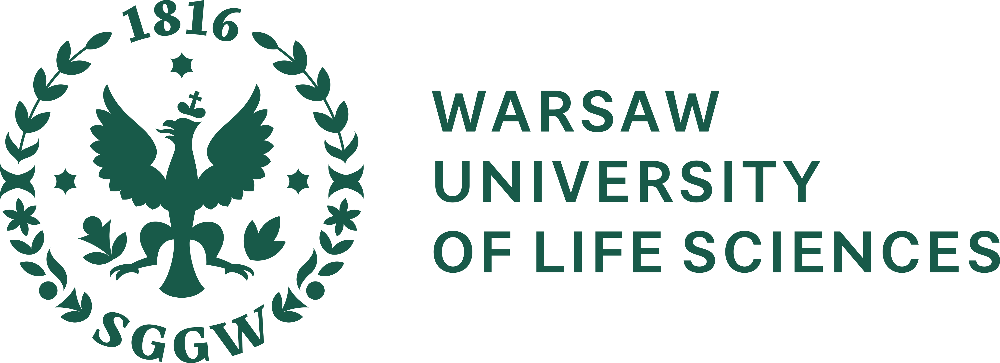

# Mariia Rutkowska

Research profile and academic CV of Mariia Rutkowska: publications, experience, education and BioGenies news.

## Biography

Hi! My name is Mariia Solovianova, and I am a biotechnologist with a strong interest in bioinformatics.

I am currently on an Erasmus exchange at the Medical University of Białystok, where I have the opportunity to expand my knowledge and gain new experiences.

Right now, I am working with Valen on the AmyloGraph Antibody Database, exploring antibody-amyloid interactions.

## Contact

[Email](mailto:solovianova.mariia@gmail.com) [GitHub](https://github.com/mashasolovey) [ORCID](https://orcid.org/0009-0009-5868-6889)

## Research stays

2024-11-12 – 2025-07-11

### Laboratory of Bioinformatics and Multi-omics Analysis

Clinical Research Centre · Medical University of Białystok · Białystok · Poland

 Białystok, Poland

2024-04-01 – 2024-10-01

### OsteoHematology

BoneLab Dresden · Dresden · Germany

 Dresden, Germany

## Education

2022 – 2024  Brandenburg University of Technology Cottbus-Senftenberg MSc

 Senftenberg, Germany

Biotechnology, specialization in Laboratory Diagnostics

**Thesis:** Effect of estrogen on bone and erythropoiesis in Myelodysplastic syndrome

2022-10-01 – 2024-10-08 · Senftenberg, Germany

2018 – 2022  Warsaw University of Life Sciences BSc

 Warsaw, Poland

Biotechnology

**Thesis:** The effect of azoxymethane on the rats colorectal metabolome

2018-10-01 – 2022-02-04 · Warsaw, Poland

## Conferences, workshops and training

3 conference and training events

PTBI

2026-09-16 – 2026-09-18

### Symposium of the Polish Bioinformatics Society

 Poznań, Poland

Talks, posters & participation (1)

- Talk

  TickPacket

PTBI

2025-09-15 – 2025-09-17

### Symposium of the Polish Bioinformatics Society

 Białystok, Poland

Talks, posters & participation (1)

- Poster

  Development of AmyloGraph Antibody database

2025-05-20 – 2025-05-23

### Meeting on Non-globular proteins in the era of Machine Learning

 Vilnius, Lithuania

Talks, posters & participation (1)

- Poster

  Development of AmyloGraph Antibody database

## Explore related research

- [Mariia starts her PhD at UMB! 🎓🦠](../../subsite/posts/2025_09_17_mariia_phd_school.llms.md)

[BioGenies publications](../../subsite/publications.llms.md) · [Research & impact](../../subsite/research.llms.md) · [All research news](../../index.llms.md)
