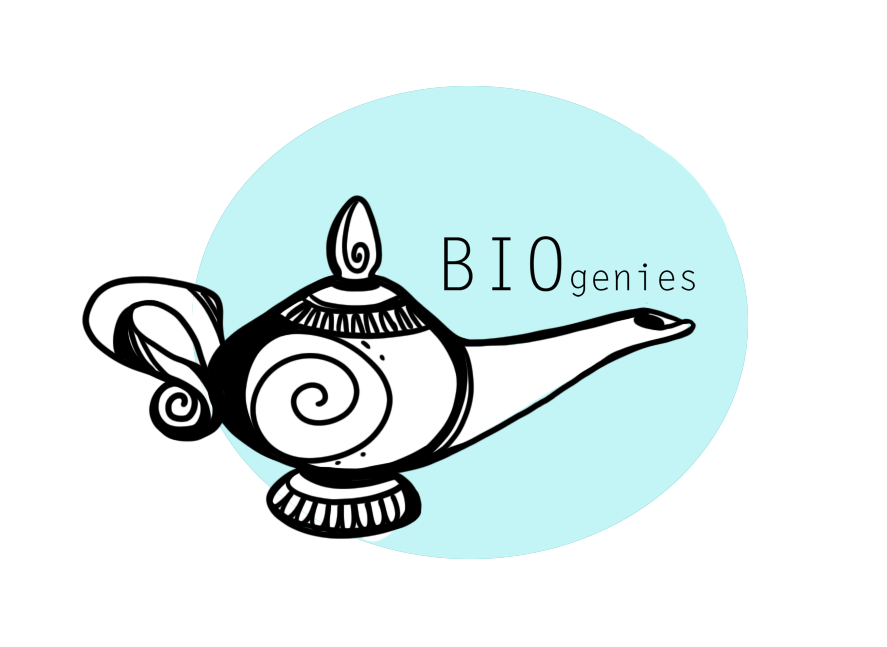
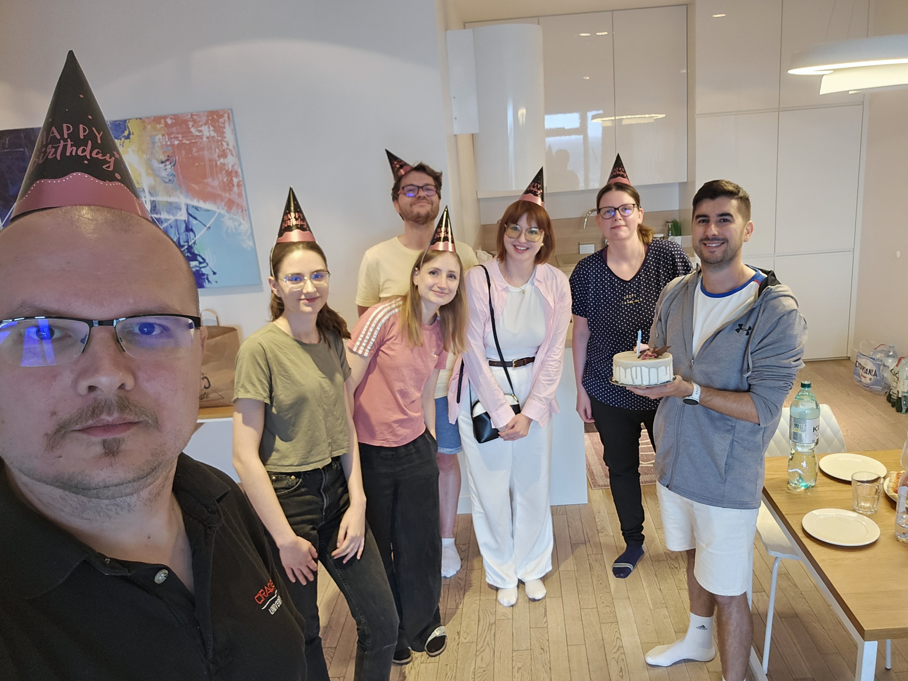

::: {.about-hero}
::: {.about-hero-copy}
[SCIENCE THROUGH CONNECTIONS]{.eyebrow}

## Biological questions. Computational imagination.

We are BioGenies: a research community bringing together bioinformatics, multiomics, protein science and machine learning. We build methods, data resources and software to connect molecular observations with biological understanding.

[Meet our people](team.qmd){.research-button} [Explore our research](research.qmd){.research-button .secondary}
:::

::: {.about-brand}
{fig-alt="BioGenies logo"}
:::
:::

## What brings us together

::: {.focus-grid}
::: {.focus-card}
[01 / MOLECULES]{.eyebrow}

### How do proteins interact and assemble?

We investigate amyloid aggregation, its modulators and the interactions that shape protein behaviour, connecting sequence and structure with experiments.

[Amyloids & aggregation](topics/amyloids.qmd) · [Phase separation](topics/llps.qmd)
:::
::: {.focus-card}
[02 / DATA]{.eyebrow}

### How can we learn more from omics data?

We develop approaches to missing values and multiomics analysis, with an emphasis on comparing methods and making analyses reproducible.

[Missing-value imputation](topics/mvi.qmd) · [HDX-MS](topics/hdxms.qmd)
:::
::: {.focus-card}
[03 / METHODS]{.eyebrow}

### How do we turn research into useful tools?

We combine curated biological knowledge, statistical modelling and machine learning in resources that other researchers can explore and reuse.

[Software & databases](software.qmd) · [Antimicrobial peptides](topics/amp.qmd)
:::
:::

::: {.about-community}
::: {.about-community-copy}
[PEOPLE MAKE THE SCIENCE]{.eyebrow}

## A shared curiosity, across institutions.

Our work grows through conversations, shared experiments and the different perspectives of our [team](team.qmd), [collaborators](colab.qmd) and [guest researchers](guest.qmd). Conferences and research exchanges help us build those connections; time together outside the lab matters too.

[Life in the group →](posts/2025_06_23_arboretum.qmd)
:::

{.community-photo fig-alt="BioGenies members celebrating together at the 2025 Wrocław retreat."}
:::

::: {.location-panel}
{.location-logo fig-alt="Medical University of Białystok logo"}

::: {.location-copy}
[OUR HOME BASE]{.eyebrow}

## Find us in Białystok

Our core team is based in the **Bioinformatics and Multiomics Analysis Laboratory**, part of the **Clinical Research Centre** at the **Medical University of Białystok**, Poland.

**Centrum Futuri · entrances D and E**

[Open location in Google Maps ↗](https://www.google.com/maps/search/?api=1&query=53.12324,23.15935) · [University website ↗](https://www.umb.edu.pl/en/index.php)
:::
:::
