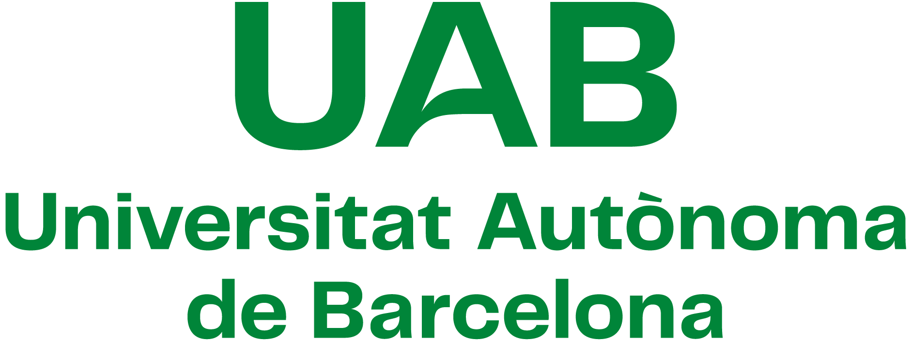
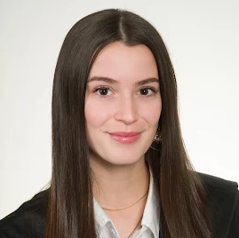
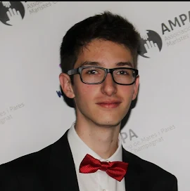
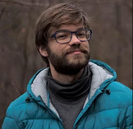
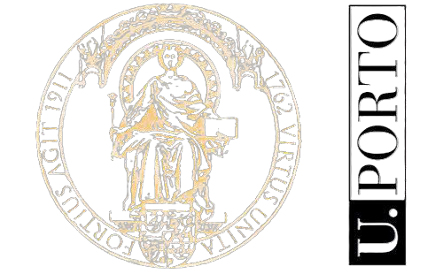
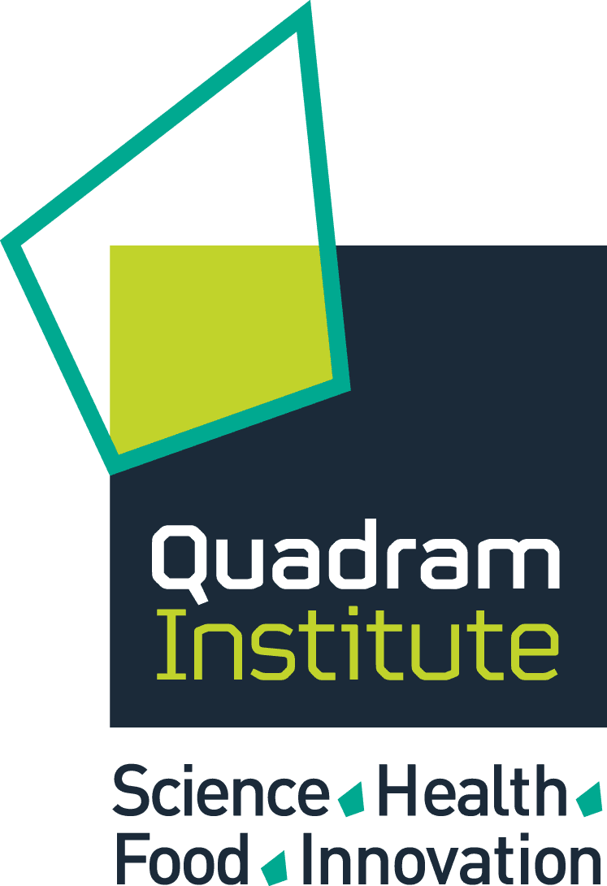

::: {.team-intro}
Good questions cross institutional boundaries. Meet the people who bring their expertise, ideas and perspectives to our research.
:::

[Our team](team.qmd) · [Guest researchers](guest.qmd) · [Research & impact](research.qmd)

## [{.directory-institution-logo}](https://www.uab.cat/en/) Autonomous University of Barcelona

```{=html}
<div class="people-grid directory-grid"><article class="person-card"><a class="person-photo" href="colab/ea.html"></a><div class="person-info"><h3><a class="person-name" href="colab/ea.html">Eva Arribas</a></h3><p>Autonomous University of Barcelona</p><a class="person-action" href="colab/ea.html">Research profile <span aria-hidden="true">↗</span></a></div></article><article class="person-card"><a class="person-photo" href="colab/ob.html"></a><div class="person-info"><h3><a class="person-name" href="colab/ob.html">Oriol Bárcenas</a></h3><p>Autonomous University of Barcelona</p><a class="person-action" href="colab/ob.html">Research profile <span aria-hidden="true">↗</span></a></div></article><article class="person-card"><a class="person-photo" href="colab/cpg.html"></a><div class="person-info"><h3><a class="person-name" href="colab/cpg.html">Carlos Pintado-Grima</a></h3><p>Autonomous University of Barcelona</p><a class="person-action" href="colab/cpg.html">Research profile <span aria-hidden="true">↗</span></a></div></article></div>
```

## [{.directory-institution-logo}](https://www.b-tu.de/en/) Brandenburg University of Technology Cottbus-Senftenberg

```{=html}
<div class="people-grid directory-grid"><article class="person-card"><a class="person-photo" href="colab/sr.html"><span class="person-initials" aria-hidden="true">SR</span></a><div class="person-info"><h3><a class="person-name" href="colab/sr.html">Stefan Rödiger</a></h3><p>Brandenburg University of Technology Cottbus-Senftenberg</p><a class="person-action" href="colab/sr.html">Research profile <span aria-hidden="true">↗</span></a></div></article><article class="person-card"><a class="person-photo" href="colab/rt.html"></a><div class="person-info"><h3><a class="person-name" href="colab/rt.html">Ronja Tittel</a></h3><p>Brandenburg University of Technology Cottbus-Senftenberg</p><a class="person-action" href="colab/rt.html">Research profile <span aria-hidden="true">↗</span></a></div></article></div>
```

## [{.directory-institution-logo}](https://nencki.edu.pl/) Nencki Institute of Experimental Biology PAS

```{=html}
<div class="people-grid directory-grid"><article class="person-card"><div class="person-photo"><span class="person-initials" aria-hidden="true">KN</span></div><div class="person-info"><h3>Kinga Nazaruk</h3><p>Nencki Institute of Experimental Biology PAS</p></div></article></div>
```

## [{.directory-institution-logo}](https://www.up.pt/portal/en/) University of Porto

```{=html}
<div class="people-grid directory-grid"><article class="person-card"><a class="person-photo" href="colab/mpo.html"></a><div class="person-info"><h3><a class="person-name" href="colab/mpo.html">Martyna Podlasiak</a></h3><p>University of Porto</p><a class="person-action" href="colab/mpo.html">Research profile <span aria-hidden="true">↗</span></a></div></article></div>
```

## [{.directory-institution-logo}](https://en.uw.edu.pl/) University of Warsaw

```{=html}
<div class="people-grid directory-grid"><article class="person-card"><a class="person-photo" href="colab/jsz.html"></a><div class="person-info"><h3><a class="person-name" href="colab/jsz.html">Julia Szkóp</a></h3><p>University of Warsaw</p><a class="person-action" href="colab/jsz.html">Research profile <span aria-hidden="true">↗</span></a></div></article></div>
```

## [{.directory-institution-logo}](https://quadram.ac.uk/) Quadram Institute

```{=html}
<div class="people-grid directory-grid"><article class="person-card"><a class="person-photo" href="colab/rk.html"><span class="person-initials" aria-hidden="true">RK</span></a><div class="person-info"><h3><a class="person-name" href="colab/rk.html">Rafał Kolenda</a></h3><p>Quadram Institute</p><a class="person-action" href="colab/rk.html">Research profile <span aria-hidden="true">↗</span></a></div></article><article class="person-card"><a class="person-photo" href="colab/ks.html"><span class="person-initials" aria-hidden="true">KS</span></a><div class="person-info"><h3><a class="person-name" href="colab/ks.html">Katarzyna (Kasia) Sidorczuk</a></h3><p>Quadram Institute</p><a class="person-action" href="colab/ks.html">Research profile <span aria-hidden="true">↗</span></a></div></article></div>
```

