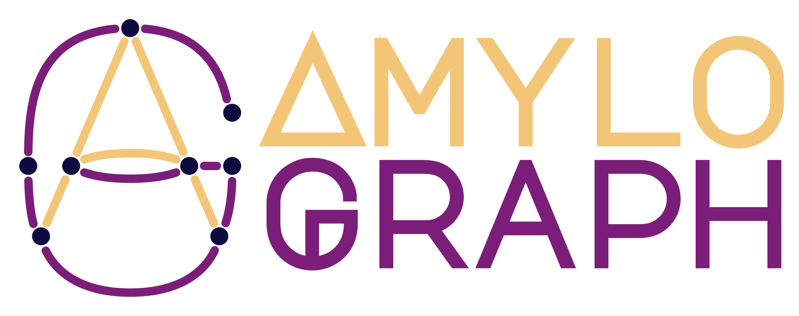

::: {.team-intro}
What was the problem? What did we build? What did we learn? Meet the questions behind three of our research tools.
:::

::: {.story-jump-links}
[Missing measurements](#imputomics) · [Interacting proteins](#amylograph) · [Protein dynamics](#hadex2)
:::

## What should fill a gap in your data? {#imputomics}

::: {.plain-story}
[IMPUTOMICS / METABOLOMICS]{.eyebrow}

::: {.story-identity}
{fig-alt="imputomics logo"}

A blank measurement is a question, not a number.
:::

### What was the problem?

Metabolomics experiments measure small molecules in biological samples, but some measurements are missing. Researchers can estimate the gaps using many different algorithms, spread across packages that can be difficult to install, compare and run consistently.

### What did we build?

imputomics brings multiple imputation methods into one R package and web application, with a common interface and a benchmarking workflow.

### What did we learn?

The published benchmark found differences in accuracy, speed and reliability across methods and missing-data scenarios. Choosing a method means considering the dataset and why values are missing. The paper provides evidence to guide that choice.

### Who can use it?

Researchers working with incomplete metabolomics data, including those who prefer a web interface to writing R code.

[Try a demo](imputation-demo.qmd){.research-button} [Open imputomics ↗](https://biogenies.info/imputomics-ws){.story-resource}

[Read the original paper, Bioinformatics (2024)](https://doi.org/10.1093/bioinformatics/btae098) · [Full group story](posts/imputomics.qmd) · [Missing-data research](topics/mvi.qmd)
:::

## What happens when amyloid proteins meet? {#amylograph}

::: {.plain-story}
[AMYLOGRAPH / PROTEIN AGGREGATION]{.eyebrow}

::: {.story-identity}
{fig-alt="AmyloGraph logo"}

Connecting experiments that used to live in separate papers.
:::

### What was the problem?

Amyloid-forming proteins can affect one another’s aggregation. Evidence for these interactions was scattered across experimental papers, using different terms and descriptions.

### What did we build?

AmyloGraph collects experimentally studied interactions in a searchable database, with a shared vocabulary and links back to the evidence. The published release brought together 883 interactions between 46 proteins or peptides.

### What did we learn?

The literature describes different kinds of effects, including faster or slower fibril formation and interactions involving physical binding. Recording these details separately helps researchers compare what experiments actually report.

### Who can use it?

Researchers exploring amyloid interactions, looking for previous experiments or assembling evidence for new questions.

[Explore AmyloGraph ↗](https://amylograph.com/){.research-button}

[Read the original paper, Nucleic Acids Research (2023 issue)](https://doi.org/10.1093/nar/gkac882) · [Full group story](posts/amylograph.qmd) · [Amyloid research](topics/amyloids.qmd)
:::

## How can we follow a protein’s changing behaviour? {#hadex2}

::: {.plain-story}
[HADEX2 / STRUCTURAL PROTEOMICS]{.eyebrow}

::: {.story-identity}
{fig-alt="HaDeX tool logo"}

Making a complex experiment easier to analyse together.
:::

### What was the problem?

Proteins move and change. Hydrogen–deuterium exchange mass spectrometry, or HDX-MS, helps investigate that behaviour by measuring deuterium uptake over time. Its results span protein regions, time points, biological conditions, charge states and repeated measurements.

### What did we build?

HaDeX2 brings statistical analysis and visualisation across those five dimensions into an R package and web application.

### What did we learn?

Considering these dimensions together helps researchers compare uptake patterns and biological conditions while accounting for experimental variability. HaDeX2 provides a common analysis framework for examining those comparisons.

### Who can use it?

Experimental and computational researchers analysing HDX-MS experiments and investigating protein structure, dynamics and interactions.

[Open HaDeX2 ↗](https://hadex2.mslab-ibb.pl/){.research-button}

[Read the original paper, Bioinformatics (2026)](https://doi.org/10.1093/bioinformatics/btag128) · [Full group story](posts/hadex2.qmd) · [HDX-MS research](topics/hdxms.qmd)
:::

[Explore all publications](publications.qmd) · [Meet the researchers](team.qmd) · [Explore our software](software.qmd)
