::: {.team-intro}
Different backgrounds. Shared curiosity. We bring together biological questions, computational thinking and a collaborative spirit.
:::

[Meet our collaborators](colab.qmd){.team-inline-link} · [Explore our research](research.qmd){.team-inline-link}

```{=html}
<div class="people-grid">
<article class="person-card"><a class="person-photo" href="team/lb.html">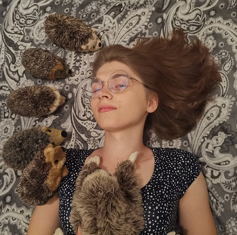</a><div class="person-info"><h3><a class="person-name" href="team/lb.html">Laura Bąkała</a></h3><p>BioGenies</p><a class="person-action" href="team/lb.html">Research profile <span aria-hidden="true">↗</span></a></div></article>
<article class="person-card"><a class="person-photo" href="team/mb.html">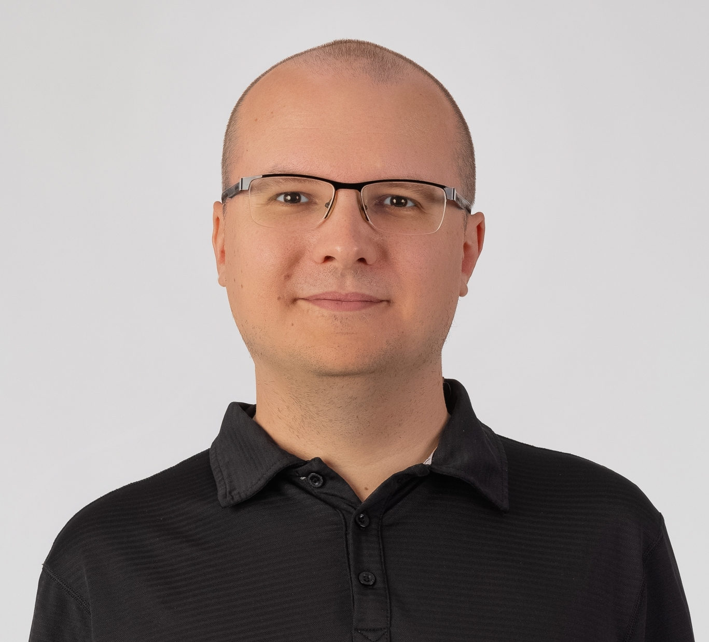</a><div class="person-info"><h3><a class="person-name" href="team/mb.html">Michał Burdukiewicz</a></h3><p>Medical University of Białystok · Vilnius University</p><div class="affiliation-logos"><a class="affiliation-link" href="https://www.umb.edu.pl/en" title="Medical University of Białystok"></a><a class="affiliation-link" href="https://www.vu.lt/en/" title="Vilnius University"></a></div><a class="person-action" href="team/mb.html">Research profile <span aria-hidden="true">↗</span></a></div></article>
<article class="person-card"><a class="person-photo" href="team/jc.html">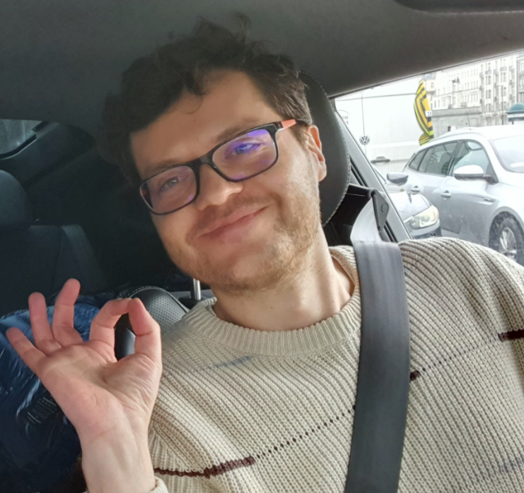</a><div class="person-info"><h3><a class="person-name" href="team/jc.html">Jarosław (Jarek) Chilimoniuk</a></h3><p>Vilnius University · Medical University of Białystok</p><div class="affiliation-logos"><a class="affiliation-link" href="https://www.vu.lt/en/" title="Vilnius University"></a><a class="affiliation-link" href="https://www.umb.edu.pl/en" title="Medical University of Białystok"></a></div><a class="person-action" href="team/jc.html">Research profile <span aria-hidden="true">↗</span></a></div></article>
<article class="person-card"><a class="person-photo" href="team/kg.html"></a><div class="person-info"><h3><a class="person-name" href="team/kg.html">Krystyna (Krysia) Grzesiak</a></h3><p>University of Geneva · University of Wrocław</p><div class="affiliation-logos"><a class="affiliation-link" href="https://www.unige.ch/en/" title="University of Geneva"></a><a class="affiliation-link" href="https://uwr.edu.pl/en/" title="University of Wrocław">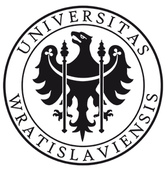</a></div><a class="person-action" href="team/kg.html">Research profile <span aria-hidden="true">↗</span></a></div></article>
<article class="person-card"><a class="person-photo" href="team/vi.html">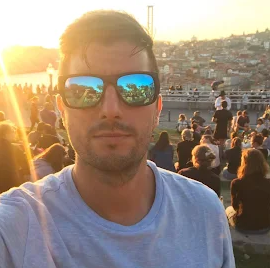</a><div class="person-info"><h3><a class="person-name" href="team/vi.html">Valentín Iglesias</a></h3><p>Medical University of Białystok</p><div class="affiliation-logos"><a class="affiliation-link" href="https://www.umb.edu.pl/en" title="Medical University of Białystok"></a></div><a class="person-action" href="team/vi.html">Research profile <span aria-hidden="true">↗</span></a></div></article>
<article class="person-card"><a class="person-photo" href="team/jk.html">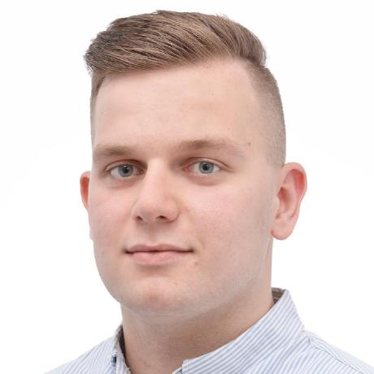</a><div class="person-info"><h3><a class="person-name" href="team/jk.html">Jakub Kołodziejczyk</a></h3><p>Google</p><div class="affiliation-logos"><a class="affiliation-link" href="https://about.google/" title="Google"></a></div><a class="person-action" href="team/jk.html">Research profile <span aria-hidden="true">↗</span></a></div></article>
<article class="person-card"><a class="person-photo" href="team/jp.html">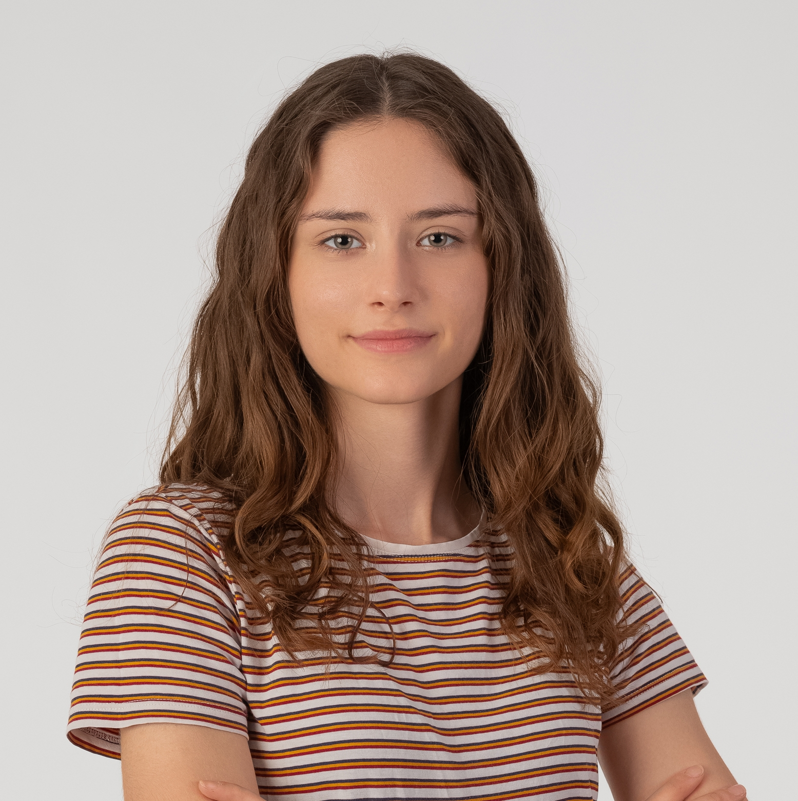</a><div class="person-info"><h3><a class="person-name" href="team/jp.html">Joanna Pokora</a></h3><p>University of Wrocław</p><div class="affiliation-logos"><a class="affiliation-link" href="https://uwr.edu.pl/en/" title="University of Wrocław"></a></div><a class="person-action" href="team/jp.html">Research profile <span aria-hidden="true">↗</span></a></div></article>
<article class="person-card"><a class="person-photo" href="team/wp.html">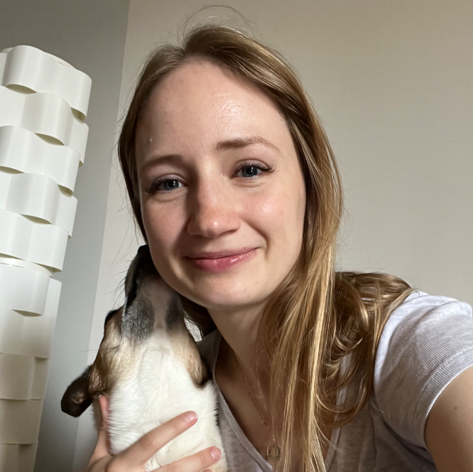</a><div class="person-info"><h3><a class="person-name" href="team/wp.html">Weronika Puchała</a></h3><p>Institute of Biochemistry and Biophysics, Polish Academy of Sciences</p><div class="affiliation-logos"><a class="affiliation-link" href="https://ibb.edu.pl/en/" title="Institute of Biochemistry and Biophysics, Polish Academy of Sciences"></a></div><a class="person-action" href="team/wp.html">Research profile <span aria-hidden="true">↗</span></a></div></article>
<article class="person-card"><a class="person-photo" href="team/mr.html">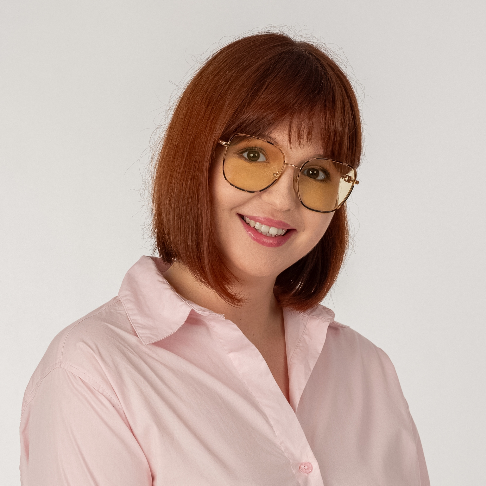</a><div class="person-info"><h3><a class="person-name" href="team/mr.html">Mariia Rutkowska</a></h3><p>Medical University of Białystok</p><div class="affiliation-logos"><a class="affiliation-link" href="https://www.umb.edu.pl/en" title="Medical University of Białystok"></a></div><a class="person-action" href="team/mr.html">Research profile <span aria-hidden="true">↗</span></a></div></article>
<article class="person-card"><div class="person-photo">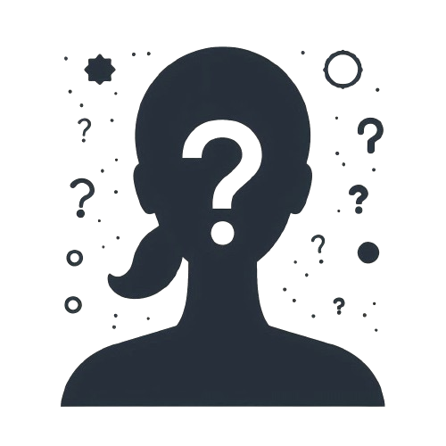</div><div class="person-info"><h3>Damian Wilary</h3><p>Medical University of Białystok</p><div class="affiliation-logos"><a class="affiliation-link" href="https://www.umb.edu.pl/en" title="Medical University of Białystok"></a></div></div></article>
</div>
```

## A group in motion {#our-mobility}

Conferences, workshops and research stays connect our team and collaborators across institutions and borders. This overview summarises the activities recorded in our academic CVs.

```{r, echo=FALSE, message=FALSE, warning=FALSE}
load("../data/bg_df_data.RData")
source("../R/resume_fun.R")
source("../R/mobility_summary.R")
team_mobility(full_df)
```

## The extended team

Our four-legged colleagues, and an important part of life around the lab.


```{=html}
<div class="pet-grid"><figure>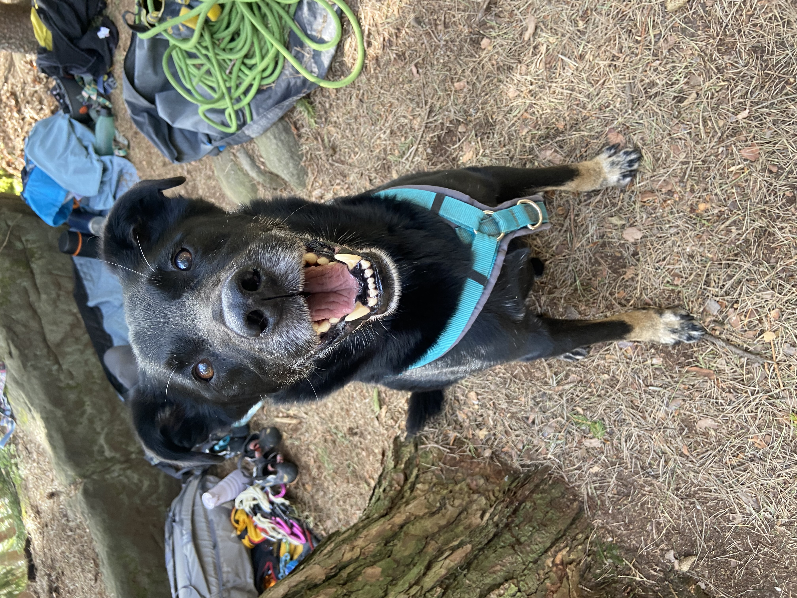<figcaption>Czarek</figcaption></figure><figure>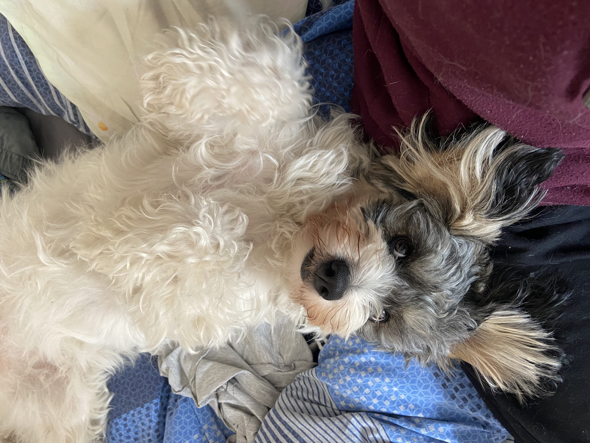<figcaption>Delma</figcaption></figure><figure><figcaption>Piksel</figcaption></figure><figure><figcaption>Invi</figcaption></figure><figure><figcaption>Lusia</figcaption></figure><figure>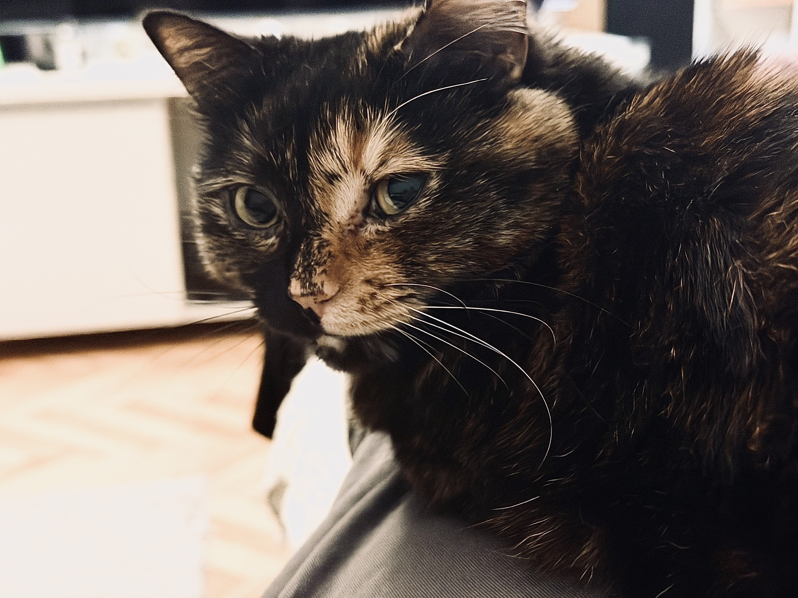<figcaption>Elis</figcaption></figure></div>
```
